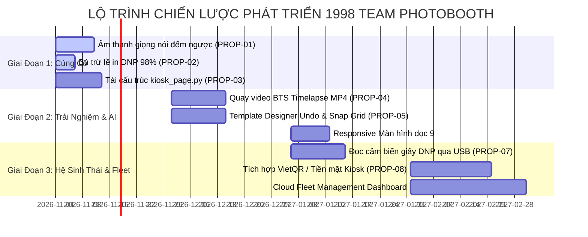

# 1998 TEAM PHOTOBOOTH — LỘ TRÌNH PHÁT TRIỂN SẢN PHẨM CHIẾN LƯỢC (PRODUCT ROADMAP)
**Phiên bản hiện tại:** v1.6.5 Build 165  
**Tầm nhìn chiến lược:** Trở thành Hệ Thống Phần Mềm Photobooth Chuyên Nghiệp Hàng Đầu Đông Nam Á dành cho Studio Cưới, Sự Kiện Thương Mại & Chuỗi Self-Photo Studio Tự Động Hóa.  
**Cơ sở dữ liệu:** Tổng hợp kết quả Nghiên Cứu Đối Thủ Cạnh Tranh (`COMPETITOR_RESEARCH_1998_TEAM.md`), Kiểm Toán Mã Nguồn Dự Án (`PROJECT_AUDIT_1998_TEAM.md`) và Kiểm Toán Trải Nghiệm Giao Diện (`UI_UX_AUDIT_1998_TEAM.md`).

---

## MỤC LỤC
1. [Ma Trận Phân Tích Khoảng Cách Năng Lực (Gap Analysis Matrix)](#1-ma-trận-phân-tích-khoảng-cách-năng-lực-gap-analysis-matrix)
   - 1.1. Những gì 1998 TEAM đã có và đang dẫn đầu thị trường
   - 1.2. Những gì 1998 TEAM đã có nhưng còn dưới chuẩn tối ưu
   - 1.3. Những tính năng trọng yếu đối thủ có mà 1998 TEAM còn thiếu
   - 1.4. Lợi thế cạnh tranh độc quyền (Differentiators)
   - 1.5. Các "cái bẫy" tính năng cần tránh (Low ROI / Distractions)
2. [Danh Mục Đề Xuất Nâng Cấp Kỹ Thuật Chi Tiết (Actionable Feature Proposals)](#2-danh-mục-đề-xuất-nâng-cấp-kỹ-thuật-chi-tiết-actionable-feature-proposals)
3. [Lộ Trình Phát Triển 3 Giai Đoạn (3-Stage Strategic Roadmap)](#3-lộ-trình-phát-triển-3-giai-đoạn-3-stage-strategic-roadmap)
   - 3.1. Giai đoạn 1 (Phase 1): Củng Cố Nền Tảng & Độ Ổn Định Vận Hành (Hardening & Reliability)
   - 3.2. Giai đoạn 2 (Phase 2): Nâng Tầm Trải Nghiệm Khách Hàng & Nâng Cấp AI (Experience & AI)
   - 3.3. Giai đoạn 3 (Phase 3): Mở Rộng Hệ Sinh Thái Chuỗi & Quản Trị Đám Mây (Enterprise Fleet & Cloud)
4. [Kế Hoạch Giám Sát, Tiêu Chuẩn Nghiệm Thu & Kiểm Thử](#4-kế-hoạch-giám-sát-tiêu-chuẩn-nghiệm-thu--kiểm-thử)

---

## 1. MA TRẬN PHÂN TÍCH KHOẢNG CÁCH NĂNG LỰC (GAP ANALYSIS MATRIX)

```
+---------------------------------------------------------------------------------------+
|                       MA TRẬN NĂNG LỰC 1998 TEAM PHOTOBOOTH                           |
+-------------------------------------------+-------------------------------------------+
| [ĐÃ CÓ & XUẤT SẮC]                        | [ĐÃ CÓ NHƯNG DƯỚI TỐI ƯU]                 |
| - Nikon MAID Type0026 USB Direct 21.5 FPS | - Trình thiết kế khung thiếu Undo/Snap    |
| - Unified Pre-Capture Face & Eye AF       | - Bộ đếm giấy máy in chưa đọc qua USB     |
| - Smart Beauty LAB Soft-Knee & Lip Tint   | - kiosk_page.py phình to (God Class)      |
| - Chia sẻ LAN nội bộ không cần Internet   | - Chưa có giao diện dọc tối ưu (Portrait) |
| - Zero UI Overlay trong buồng chụp Kiosk  | - Bù trừ lề in DNP 2x6 phải chỉnh tay     |
+-------------------------------------------+-------------------------------------------+
| [HOÀN TOÀN CHƯA CÓ - CẦN BỔ SUNG]         | [LỢI THẾ CẠNH TRANH ĐỘC QUYỀN]           |
| - Hệ thống âm thanh giọng nói đếm ngược   | - Hệ thống lấy nét mắt phần cứng Nikon AF |
| - Quay video hậu trường BTS Timelapse MP4 | - Son môi thông minh không lem răng       |
| - Tự động đồng bộ nhiều booth qua Cloud   | - Vận hành offline tuyệt đối qua LAN QR   |
| - Tích hợp cổng nhận tiền mặt / POS quẹt thẻ| - Dark Gold Studio UI sang trọng vượt bậc|
+-------------------------------------------+-------------------------------------------+
```

### 1.1. Những Gì 1998 TEAM Đã Có và Đang Dẫn Đầu Thị Trường
1. **Nikon MAID Type0026 USB Direct:** Giao tiếp C-types trực tiếp không qua phần mềm trung gian, cho tốc độ truyền khung hình Live View 21.5 FPS mượt mà.
2. **Unified Face & Eye AF Engine:** Tính năng lấy nét mắt tự động trước mỗi lần chụp trên Nikon D780 bằng AI YuNet siêu nhẹ (18-26ms) kết hợp kẹp biên an toàn và Watchdog 2.2s. Đây là tính năng mà ngay cả Breeze Remote Pro và dslrBooth đều chưa hỗ trợ ở cấp độ phần cứng camera tương đương.
3. **Smart Beauty Engine độc quyền:** Làm mịn da bảo toàn kết cấu vi mô (Bilateral + Micro-texture recovery) và nâng sáng độ tương phản mềm trong không gian màu CIELAB; tô son môi tươi tắn mà không bao giờ lem vào răng.
4. **Chia sẻ ảnh qua mạng nội bộ LAN:** Cho phép khách tải ảnh gốc và ảnh in ngay lập tức tại các sự kiện tổ chức tại tầng hầm hoặc bãi biển không có Internet.

### 1.2. Những Gì 1998 TEAM Đã Có Nhưng Còn Dưới Chuẩn Tối Ưu
1. **Trình thiết kế khung ảnh `FrameDesignerPage`:** Thiếu tính năng hút điểm lưới (Snap to Grid), thiếu các nút căn lề tự động (Align Left/Center/Top), và đặc biệt là thiếu lịch sử hoàn tác Undo/Redo (`Ctrl+Z`).
2. **Bộ đếm giấy máy in DNP RX1HS:** Hiện chỉ đếm trừ dần theo phần mềm trên biến RAM/Config, chưa đọc trực tiếp cảm biến phần cứng qua cổng USB/SNMP.
3. **Mã nguồn `kiosk_page.py`:** Phình to tới hơn 2.390 dòng code, tích tụ nhiều trách nhiệm khác nhau, cần được module hóa.
4. **Tính tương thích màn hình dọc (Portrait Orientation):** Chưa có cơ chế tự thích ứng khi xoay màn hình cảm ứng 90 độ (phong cách Photo Booth Hàn Quốc).

### 1.3. Những Tính Năng Trọng Yếu Đối Thủ Có Mà 1998 TEAM Còn Thiếu
1. **Hệ thống âm thanh chỉ dẫn đếm ngược (Audio Voice Prompts):** Đối thủ Maytech và Breeze phát giọng nói "Ba, hai, một... Cười lên nào!" giúp tăng 200% phản xạ chú ý của khách.
2. **Quay video hậu trường Behind-The-Scenes (BTS Timelapse Video MP4):** Xu hướng số 1 của giới trẻ hiện nay là quét mã QR để tải video ngắn 15s ghi lại quá trình tạo dáng nhí nhố bên cạnh dải ảnh in.
3. **Bù trừ lề in DNP tự động (98% Scale Factor):** Kỹ thuật học từ HihiBooth giúp triệt tiêu hoàn toàn nguy cơ dao cắt máy DNP chém vào chữ hay viền ảnh.

### 1.4. Lợi Thế Cạnh Tranh Độc Quyền (Differentiators)
- **Studio Quality Output:** Ảnh chụp từ máy ảnh DSLR/Mirrorless Full-frame Nikon D780 qua ống kính quang học chất lượng cao, lấy nét chuẩn xác vào đồng tử mắt của khách, vượt xa chất lượng mờ nhòe của các booth dùng iPad hay webcam thông thường.
- **Bảo toàn ảnh gốc 100%:** Studio luôn có kho ảnh gốc độ phân giải cao để hậu kỳ hoặc in album lớn cho cô dâu chú rể.

### 1.5. Các "Cái Bẫy" Tính Năng Cần Tránh (Low ROI / Distractions)
- **Không tự viết engine 3D / AR Filter phức tạp (khuôn mặt tai thỏ, biến dạng 3D):** Việc này tiêu tốn hàng ngàn giờ kỹ thuật nhưng trải nghiệm trên desktop không thể mượt bằng Instagram/Snapchat và không phù hợp với phân khúc tiệc cưới sang trọng.
- **Không nhúng trình duyệt cồng kềnh Electron vào lõi:** Giữ vững nền tảng PySide6 C++ bindings để duy trì bộ nhớ RAM dưới 300MB và khởi động dưới 3 giây.

---

## 2. DANH MỤC ĐỀ XUẤT NÂNG CẤP KỸ THUẬT CHI TIẾT (ACTIONABLE PROPOSALS)

| Mã Đề Xuất | Tên Đề Xuất Nâng Cấp | Bằng Chứng / Nguồn Gốc | Lợi Ích Mang Lại | Độ Phức Tạp | Mức Ưu Tiên |
| :--- | :--- | :--- | :--- | :---: | :---: |
| **PROP-01** | **Hệ thống Âm thanh Chỉ dẫn Đếm ngược & Chụp** | Maytech (`SoundCountdown`), Breeze | Tăng sự chú ý của khách, giảm ảnh hỏng do chớp mắt | Thấp (1-2 ngày) | **P0 (Cấp thiết)** |
| **PROP-02** | **Bù trừ Lề In DNP Tự Động (98% Anti-Clipping)** | HihiBooth (`print_dnp.ps1`) | Chống dao cắt DNP chém mất chữ/viền khung | Thấp (1 ngày) | **P0 (Cấp thiết)** |
| **PROP-03** | **Tái Cấu Trúc Module Kiosk (Tách God Class)** | Code Audit (`kiosk_page.py`) | Giảm nợ kỹ thuật, dễ bảo trì và mở rộng tính năng | Trung bình (3-4 ngày) | **P1 (Quan trọng)**|
| **PROP-04** | **Quay Video Hậu Trường (BTS Timelapse MP4)** | Pixture.io, Maytech (`TimeSlap`) | Đột phá trải nghiệm khách Gen Z, tăng độ viral MXH | Trung bình (3 ngày) | **P1 (Quan trọng)**|
| **PROP-05** | **Nâng Cấp Trình Thiết Kế Khung Ảnh (Undo/Snap)**| UI Audit (`FrameDesignerPage`) | Kỹ thuật viên thiết kế template nhanh gấp 3 lần | Trung bình (4 ngày) | **P1 (Quan trọng)**|
| **PROP-06** | **Chế Độ Màn Hình Cảm Ứng Dọc (Portrait 9:16)** | Maytech (`AppOrientation: 90`) | Mở rộng thị trường trạm tự động phong cách Hàn Quốc | Trung bình (3 ngày) | **P2 (Nâng cao)** |
| **PROP-07** | **Đọc Trạng Thái Giấy/Mực DNP Qua Cổng USB** | Breeze Hub, Maytech (`MediaMonitor`)| Báo động chính xác khi cuộn giấy còn dưới 10% | Trung bình (3-5 ngày)| **P2 (Nâng cao)** |
| **PROP-08** | **Tích Hợp Cổng Nhận Tiền Mặt / VietQR Tự Động** | Maytech (ICT L70), Pixture | Biến booth thành trạm tự doanh (Unattended Kiosk) | Cao (1-2 tuần) | **P3 (Mở rộng)** |

---

## 3. LỘ TRÌNH PHÁT TRIỂN 3 GIAI ĐOẠN (3-STAGE STRATEGIC ROADMAP)



---

### 3.1. GIAI ĐOẠN 1 (PHASE 1): CỦNG CỐ NỀN TẢNG & ĐỘ ỔN ĐỊNH VẬN HÀNH (HARDENING & RELIABILITY)
*Mục tiêu: Hoàn thiện 100% trải nghiệm cốt lõi tại sự kiện, triệt tiêu mọi rủi ro in ấn và hư hại khung ảnh.*

#### 1. Tích Hợp Hệ Thống Âm Thanh Đếm Ngược & Chỉ Dẫn Giọng Nói (PROP-01 - P0)
- **Kiến trúc:** Thêm module `vietphotobooth/audio/sound_controller.py` sử dụng `QSoundEffect` của PySide6 (không dùng thư viện ngoài nặng nề như pygame).
- **Tài nguyên:** 
  - `countdown_tick.wav`: Tiếng tít nhịp điệu (1000ms/lần).
  - `countdown_voice_3.wav`, `_2.wav`, `_1.wav`: Giọng đọc tiếng Việt chuyên nghiệp, ấm áp.
  - `capture_shutter.wav`: Âm thanh màn trập cơ học mô phỏng tiếng gương lật studio.
  - `smile_prompt.wav`: "Cười tươi lên nào!".
- **Tích hợp:** Kiosk Controller kích hoạt phát âm thanh đồng bộ với `countdown_timer`. Có switch bật/tắt âm thanh trong Settings.

#### 2. Tự Động Bù Trừ Lề In & Chống Cắt Phạm DNP RX1HS (PROP-02 - P0)
- **Kiến trúc:** Cập nhật `vietphotobooth/printing/spooler.py` và `dnp_rx1hs.py`.
- **Cơ chế:** Khi gửi ảnh sang HDC máy in DNP, tự động áp dụng hệ số scale an toàn **98% (0.98)** và căn giữa bộ đệm (Offset tự động 1%), tạo vùng an toàn (Safety Margin) 2% quanh mép giấy. Đảm bảo 100% không bao giờ bị lưỡi dao chém mất chữ của khách.

#### 3. Tái Cấu Trúc Bền Vững Module Kiosk (PROP-03 - P1)
- Tách `vietphotobooth/desktop/widgets/kiosk_page.py` thành:
  - `kiosk/kiosk_page.py`: Widget giao diện chính.
  - `kiosk/capture_orchestrator.py`: Điều phối luồng đếm ngược, lấy nét AF, capture token và watchdog.
  - `kiosk/review_flow.py`: Xử lý sau chụp và chuyển sang dialog hoàn thiện.

---

### 3.2. GIAI ĐOẠN 2 (PHASE 2): NÂNG TẦM TRẢI NGHIỆM KHÁCH HÀNG & NÂNG CẤP AI (EXPERIENCE & AI)
*Mục tiêu: Đột phá tính năng tương tác, biến dải ảnh tĩnh thành sản phẩm video sống động và tối ưu hóa công cụ thiết kế.*

#### 1. Quay Video Hậu Trường Behind-The-Scenes (BTS Timelapse MP4) (PROP-04 - P1)
- **Kiến trúc:** Thêm `vietphotobooth/processing/timelapse_recorder.py`.
- **Cơ chế:** 
  - Trong lúc Live View đếm ngược mỗi kiểu chụp, trích xuất 5-10 frame/giây ghi vào hàng đợi bộ nhớ.
  - Khi chụp xong shot cuối cùng, một background worker sử dụng OpenCV `cv2.VideoWriter(..., cv2.VideoWriter_fourcc(*'mp4v'), 15, (640, 480))` ghép các frame lại thành video timelapse 10-15 giây.
  - Gắn watermark logo 1998 Studio ở góc video.
  - Lưu video vào thư mục phiên chụp `Events/<Event>/Prints/session_{id}_bts.mp4`.
  - Cập nhật trang QR để khi khách quét mã trên điện thoại, khách có thể tải cả **Dải ảnh in** lẫn **Clip Video Hậu Trường** để đăng Story/Reels.

#### 2. Nâng Cấp Toàn Diện Trình Thiết Kế Khung Ảnh `FrameDesignerPage` (PROP-05 - P1)
- **Undo / Redo:** Tích hợp `QUndoStack` và `QUndoCommand` cho các thao tác: Thêm slot, xóa slot, di chuyển, co giãn, đổi màu nền.
- **Hút điểm lưới (Snap to Grid):** Tùy chọn lưới 10px hoặc 20px; khi mép ô ảnh cách đường lưới dưới 6px, tự động hút dính.
- **Thanh công cụ căn lề (Alignment Bar):** Căn mép trái, căn mép phải, căn giữa ngang, căn giữa dọc, chia đều khoảng cách các ô ảnh (Distribute evenly).

#### 3. Hỗ Trợ Màn Hình Cảm Ứng Dọc Tự Động (Portrait Kiosk Mode 9:16) (PROP-06 - P2)
- Tự động kiểm tra tỷ lệ màn hình `width / height`. Nếu < 1.0 (màn hình đứng):
  - Tự động tái bố trí giao diện: Khung Live View đặt ở nửa trên màn hình (chiếm 65% chiều cao).
  - Hàng điều khiển chọn ảnh, đếm ngược và nút Bắt đầu chụp xếp gọn ở nửa dưới.
  - Đảm bảo trọn vẹn trải nghiệm của các trạm Photobooth thế hệ mới.

---

### 3.3. GIAI ĐOẠN 3 (PHASE 3): MỞ RỘNG HỆ SINH THÁI CHUỖI & QUẢN TRỊ ĐÁM MÂY (ENTERPRISE FLEET & CLOUD)
*Mục tiêu: Chuyển mình từ phần mềm đơn máy thành nền tảng quản trị chuỗi nhượng quyền thương mại Photobooth.*

#### 1. Giám Sát Cảm Biến Giấy/Mực Máy In DNP Qua Cổng USB Thực Tế (PROP-07 - P2)
- Giao tiếp trực tiếp với driver DNP hoặc lệnh SNMP qua Win32 API `OpenPrinter` / `GetPrinterData`.
- Đọc thông số phần cứng: `Remaining Media Counter` (Số kiểu còn lại của cuộn giấy), `Printer Error Status` (Hết giấy, hết ribbon, kẹt dao cắt, mở nắp).
- Bật banner cảnh báo màu vàng trên màn hình Admin khi số lượng bản in thực tế còn dưới 10% (dưới 40 bản).

#### 2. Tích Hợp Hệ Thống Tự Động Thanh Toán VietQR / POS / Tiền Mặt (PROP-08 - P3)
- Hỗ trợ mô hình Photobooth tự phục vụ không cần nhân viên trực (Unattended Kiosk):
  - Sinh mã VietQR động theo phiên chụp (ví dụ: 50.000 VNĐ / 2 dải ảnh).
  - Kết nối Webhook ngân hàng (SeABank, Techcombank, MBBank) kiểm tra biến động số dư.
  - Hỗ trợ kết nối cổng Serial COM với đầu đọc tiền giấy tự động (ICT L70 / TOP TB74).
  - Khi nhận tiền thành công -> Tự động mở khóa kích hoạt phiên chụp cho khách.

#### 3. Cloud Fleet Management Dashboard (P3)
- Bảng điều khiển trực tuyến dành cho chủ studio quản lý nhiều trạm Photobooth từ xa qua Web:
  - Xem số lượng khách chụp theo thời gian thực của từng trạm.
  - Theo dõi lượng giấy in còn lại của từng máy.
  - Đẩy mẫu khung ảnh mới (Templates) xuống toàn bộ các máy trong chuỗi chỉ bằng một cú nhấp chuột.

---

## 4. KẾ HOẠCH GIÁM SÁT, TIÊU CHUẨN NGHIỆM THU & KIỂM THỬ

Mọi tính năng mới được triển khai trong lộ trình phải tuân thủ nghiêm ngặt **Quy Tắc Phát Triển 1998 TEAM**:
1. **Kiểm thử tự động trước khi release:** Bổ sung unit test và integration test tương ứng cho từng tính năng mới, duy trì tỷ lệ **100% test pass**.
2. **Quy tắc Single Source of Truth:** Luôn tăng phiên bản và số build trong `vietphotobooth/version.py` mỗi khi hoàn thành sửa đổi.
3. **Bảo tồn tính năng lõi:** Tuyệt đối không làm ảnh hưởng đến tính ổn định của backend Nikon MAID Type0026 và kiến trúc Unified AF Engine đã được chứng minh hiệu quả thực tế.
