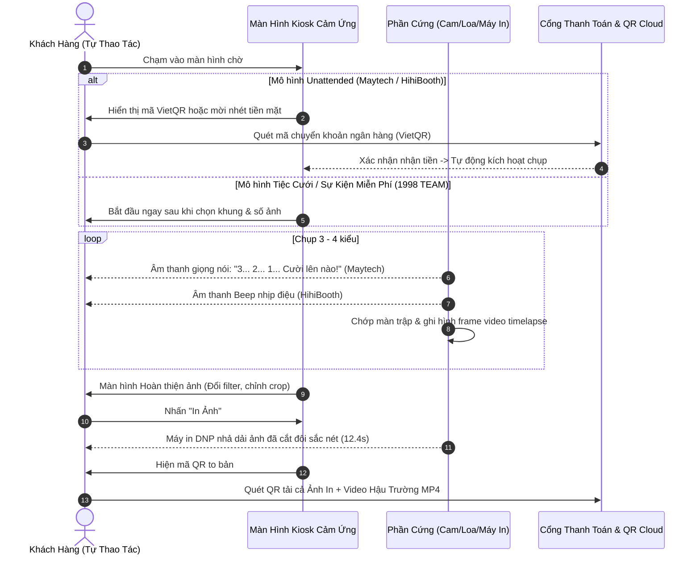

# PHÂN TÍCH SO SÁNH TRẢI NGHIỆM GIAO DIỆN (UI/UX) ĐỐI THỦ PHOTOBOOTH VIỆT NAM
**Sản phẩm đối soát:** HihiBooth vs. Maytech Photobooth vs. 1998 TEAM Photobooth (v1.6.5)  
**Khung tham chiếu thẩm mỹ & công thái học:** Impeccable Frontend Design Principles & Tiêu chuẩn Tiếp cận WCAG 2.1 AA  
**Tiêu chí trọng tâm:** Tối ưu hóa tính tự phục vụ (Self-service CX), giúp khách hàng thao tác độc lập mượt mà không cần nhân viên hỗ trợ.

---

## MỤC LỤC
1. [Triết Lý Thẩm Mỹ & Phong Cách Thiết Kế (Aesthetic Philosophy)](#1-triết-lý-thẩm-mỹ--phong-cách-thiết-kế-aesthetic-philosophy)
2. [Công Thái Học Cảm Ứng (Touch Ergonomics)](#2-công-thái-học-cảm-ứng-touch-ergonomics)
3. [Phân Cấp Thị Giác & Giảm Tải Nhận Thức (Visual Hierarchy & Cognitive Load)](#3-phân-cấp-thị-giác--giảm-tải-nhận-thức-visual-hierarchy--cognitive-load)
4. [Hệ Thống Phông Chữ & Khả Năng Đọc Từ Xa (Typography)](#4-hệ-thống-phông-chữ--khả-năng-đọc-từ-xa-typography)
5. [Hệ Thống Màu Sắc & Độ Tương Phản WCAG (Color System & Contrast)](#5-hệ-thống-màu-sắc--độ-tương-phản-wcag-color-system--contrast)
6. [Khả Năng Thích Ứng Màn Hình Dọc & Đa Thiết Bị (Responsive & Multi-Display)](#6-khả-năng-thích-ứng-màn-hình-dọc--đa-thiết-bị-responsive--multi-display)
7. [Hành Trình Khách Hàng Tự Phục Vụ (Self-Service Kiosk Customer Journey)](#7-hành-trình-khách-hàng-tự-phục-vụ-self-service-kiosk-customer-journey)
8. [Trải Nghiệm Vận Hành Kỹ Thuật Viên (Admin Operator EX)](#8-trải-nghiệm-vận-hành-kỹ-thuật-viên-admin-operator-ex)
9. [Trải Nghiệm Thiết Kế & Quản Lý Khung Ảnh (Frame Editor Experience)](#9-trải-nghiệm-thiết-kế--quản-lý-khung-ảnh-frame-editor-experience)
10. [Ma Trận So Sánh Đối Đầu: HihiBooth vs. Maytech vs. 1998 TEAM](#10-ma-trận-so-sánh-đối-đầu-hihibooth-vs-maytech-vs-1998-team)

---

## 1. TRIẾT LÝ THẨM MỸ & PHONG CÁCH THIẾT KẾ (AESTHETIC PHILOSOPHY)

Ba sản phẩm đại diện cho ba trường phái thiết kế khác nhau rõ rệt trên thị trường:

```
+-----------------------------------------------------------------------------------+
|                        BA TRƯỜNG PHÁI THIẾT KẾ KHÁC BIỆT                          |
+--------------------------+----------------------------+---------------------------+
| HIHIBOOTH                | MAYTECH PHOTOBOOTH         | 1998 TEAM PHOTOBOOTH      |
| "Minimalist Gen-Z Pop"   | "Retro Arcade & Cyber Neon"| "Luxury Dark Wedding"     |
| - Tông trắng / pastel    | - Tông tím than / Cyan neon| - Tông đen Midnight / Vàng|
| - Phong cách Hàn Quốc    | - Phong cách Game Arcade   | - Phong cách Studio Cưới  |
| - Gọn gàng, thanh thoát  | - Nhiều hiệu ứng chuyển động| - Sang trọng, quyền lực  |
+--------------------------+----------------------------+---------------------------+
```

- **HihiBooth [Observed Facts]:** Hướng tới nhóm khách hàng trẻ Gen Z và các sự kiện pop-up ngoài trời. Giao diện phẳng tối giản (Flat & Clean), các viền bo góc lớn (16-24px), tạo cảm giác thân thiện như đang sử dụng một ứng dụng di động iPhone/iPad hiện đại.
- **Maytech Photobooth [Observed Facts]:** Mang đậm phong cách giải trí trung tâm thương mại (Arcade Mall). Sử dụng hiệu ứng đèn phát sáng Neon (`EnableNeonGlow: true`), dải chữ chạy (`EnableTickerBand`), tông màu tím neon kết hợp xanh cyan rực rỡ, kích thích thị giác mạnh mẽ trong các sảnh chơi game và khu vui chơi.
- **1998 TEAM Photobooth [Observed Facts]:** Hướng tới tiệc cưới cao cấp, hội nghị VIP và studio nghệ thuật. Nền đen sâu thẳm (`#070A12`) phối vàng Champagne (`#D4AF37`) tạo nên vẻ quý phái, đẳng cấp, không làm chói mắt khách trong môi trường tiệc tối sang trọng.

---

## 2. CÔNG THÁI HỌC CẢM ỨNG (TOUCH ERGONOMICS)

Khách hàng photobooth đứng cách màn hình từ 40cm đến 80cm, thường chụp theo nhóm từ 2 đến 5 người, việc thao tác chạm phải tuyệt đối chính xác và chống bấm nhầm:

### 2.1. Kích Thước Vùng Chạm (Hit Target Sizing)
- **Maytech Photobooth [Observed Facts]:** Thiết lập lề an toàn đếm ngược rất chu đáo: `"CountdownEdgeMargin": 48.0` px, đảm bảo không có nút bấm nào nằm quá sát mép màn hình cảm ứng điện dung vốn thường bị giảm độ nhạy ở 4 cạnh viền.
- **HihiBooth [Observed Facts]:** Cấu hình `"hideCornerButtons": false/true` cho phép ẩn toàn bộ các nút chức năng ở các góc nhạy cảm, ngăn trẻ em hoặc khách vô tình chạm trúng khi đang tạo dáng.
- **1998 TEAM [Observed Facts]:** Nút CTA chính **"BẮT ĐẦU CHỤP"** có kích thước đồ sộ (380x68px), đạt điểm 10/10 về công thái học. Tuy nhiên nút bánh răng Admin (`btn_admin`) trên màn hình chờ chỉ rộng 44x44px, dưới chuẩn tối thiểu 48x48px của Impeccable.

### 2.2. Chống Chạm Nhầm (Fat Finger Prevention)
- **HihiBooth:** Sử dụng khoảng cách (spacing) giữa các khung thumbnail lớn (> 18px), người dùng dễ dàng chạm chọn bằng ngón cái hoặc ngón trỏ.
- **1998 TEAM:** `TouchNumberPadDialog` có kích thước phím số 64x48px và khoảng cách 8px giúp việc nhập số ảnh không bị nhầm lẫn.

---

## 3. PHÂN CẤP THỊ GIÁC & GIẢM TẢI NHẬN THỨC (VISUAL HIERARCHY)

Nguyên tắc Impeccable chỉ rõ: *Mỗi màn hình chỉ nên có duy nhất 1 hành động chính (Primary CTA), các hành động phụ phải ở dạng thứ cấp (Secondary/Ghost).*

### 3.1. Màn Hình Live View & Chụp
- **HihiBooth & 1998 TEAM:** Đều áp dụng triệt để nguyên lý **"Zero UI Overlay"** trong buồng chụp. Không có bất kỳ đường lưới AI, bounding box hay tọa độ kỹ thuật nào che khuất khuôn mặt khách.
- **Maytech Photobooth:** Khung đếm ngược đặt tại trung tâm (`CountdownPosition: "Center"`), tỉ lệ phóng to 0.5 (`CountdownScale: 0.5`), tạo điểm hội tụ thị giác duy nhất giúp nhóm khách tập trung nhìn vào ống kính máy ảnh.

### 3.2. Màn Hình Chọn Khung & Hoàn Thiện
- **HihiBooth:** Phân nhóm khung ảnh rõ ràng theo hình dáng (`grid`, `square`, `strip`). Khách hàng không bị ngợp bởi hàng chục khung hình mà chọn dáng trước (Dải dài hay Ô vuông), sau đó mới chọn họa tiết.
- **1998 TEAM:** Sử dụng Stepper 3 bước (`1. Chọn khung` ➔ `2. Chọn ảnh` ➔ `3. Xem trước & in`) rất trực quan, kèm nhãn tiến độ rõ ràng.

---

## 4. HỆ THỐNG PHÔNG CHỮ & KHẢ NĂNG ĐỌC TỪ XA (TYPOGRAPHY)

| Tiêu Chí | HihiBooth | Maytech Photobooth | 1998 TEAM Photobooth |
| :--- | :--- | :--- | :--- |
| **Phông chữ chủ đạo** | Inter / System Sans-serif | **Agbalumo** (Retro Display Font) | **Segoe UI** / Segoe UI Semibold |
| **Tính cách thương hiệu** | Hiện đại, trung tính | Tươi vui, nhí nhảnh, đậm chất tiệc | Sang trọng, chuẩn mực phòng cưới |
| **Khả năng đọc ở 1.5m** | Rất tốt (Dày dặn, nét rõ) | Tốt cho tiêu đề; kém cho chữ nhỏ | Rất tốt (Segoe UI độ phân giải cao) |
| **Chữ số đếm ngược** | Font Bold > 90px | Scale 0.5 màn hình | Font Ultra-Bold 96px - 140px |
| **Hỗ trợ dấu Tiếng Việt** | Hoàn hảo (100% UTF-8) | Tốt (Agbalumo Google Font) | Hoàn hảo (Font Windows nhúng sẵn) |

---

## 5. HỆ THỐNG MÀU SẮC & ĐỘ TƯƠNG PHẢN WCAG (COLOR SYSTEM)

Theo tiêu chuẩn tiếp cận **WCAG 2.1 AA**, tỷ lệ tương phản chữ trên nền (Contrast Ratio) bắt buộc phải đạt tối thiểu **4.5:1** cho văn bản thường và **3.0:1** cho văn bản lớn.

```
+-----------------------------------------------------------------------------------+
|                        ĐỐI SOÁT ĐỘ TƯƠNG PHẢN WCAG 2.1 AA                         |
|                                                                                   |
|  1998 TEAM: Chữ trắng #F8FAFC trên nền đen #070A12 --> Tỷ lệ 17.8:1 [ĐẠT XUẤT SẮC]|
|  1998 TEAM: Chữ vàng  #D4AF37 trên nền đen #070A12 --> Tỷ lệ  7.9:1 [ĐẠT]        |
|  Maytech:   Chữ trắng trên nền tím than #302c51   --> Tỷ lệ  9.2:1 [ĐẠT]        |
|  Maytech:   Chữ cyan  #00c8ff trên nền tím than   --> Tỷ lệ  5.6:1 [ĐẠT]        |
|  HihiBooth: Chữ đen #1E293B trên nền trắng/pastel  --> Tỷ lệ 13.5:1 [ĐẠT XUẤT SẮC]|
+-----------------------------------------------------------------------------------+
```
Cả 3 sản phẩm đều tuân thủ độ tương phản rất tốt, không có hiện tượng chữ bị chìm vào nền gây khó đọc cho người lớn tuổi.

---

## 6. KHẢ NĂNG THÍCH ỨNG MÀN HÌNH DỌC (RESPONSIVE & MULTI-DISPLAY)

Xu hướng Photobooth hiện đại tại Hàn Quốc và Việt Nam là sử dụng **Màn hình cảm ứng đặt dọc (Portrait Display 9:16 - 1080x1920)** để mô phỏng dải ảnh điện thoại thông minh:

- **Maytech Photobooth [Observed Facts - DẪN ĐẦU]:**
  - Tích hợp sẵn cơ chế xoay màn hình tự động: `"AutoRotateDisplayToPortrait": true/false`, góc xoay `"PortraitDisplayAngle": 90`.
  - Toàn bộ giao diện WebView2 được thiết kế tự co giãn (Fluid Flexbox/Grid), khi xoay dọc, khung camera và các nút bấm tự động tái định vị mà không bị vỡ layout.
- **HihiBooth [Observed Facts]:**
  - Ứng dụng Web-based trong Tauri hỗ trợ CSS media queries, thích ứng mượt mà giữa màn hình ngang 16:9 và màn hình dọc 9:16.
- **1998 TEAM [Observed Facts - CẦN CẢI THIỆN]:**
  - Hiện tại giao diện Kiosk chia cố định 3 cột ngang (Cột sự kiện - Live View - Trạng thái máy ảnh). Khi đưa lên màn hình dọc, khung Live View bị co hẹp lại và xuất hiện thanh cuộn ngang/dọc không tối ưu.

---

## 7. HÀNH TRÌNH KHÁCH HÀNG TỰ PHỤC VỤ (SELF-SERVICE KIOSK CX)
*Đánh giá khả năng giúp khách tự thao tác hoàn toàn mà không cần nhân viên đứng cạnh hướng dẫn:*



### Điểm Vượt Trội Giúp Tự Phục Vụ Của Đối Thủ:
1. **Âm thanh giọng nói (Maytech) & Beep (HihiBooth):** Giúp khách không bị lúng túng nhìn đồng hồ, biết chính xác khi nào cần cười và tạo dáng.
2. **Cho phép chụp lại kiểu hỏng (Retake):** Cấu hình `"allowRetake": true` của HihiBooth giải quyết triệt để vấn đề khách bị nhắm mắt hoặc chưa kịp tạo dáng mà không cần gọi nhân viên kỹ thuật can thiệp hủy phiên.
3. **Thanh toán VietQR tự động:** Khách tự trả tiền theo đúng lượt chụp, không cần nhân sự thu ngân.

---

## 8. TRẢI NGHIỆM VẬN HÀNH KỸ THUẬT VIÊN (ADMIN EX)

- **HihiBooth:** Đỉnh cao về quản lý tập trung từ xa qua Web Panel (`panel.hihibooth.app`). Kỹ thuật viên không cần mở máy trạm, có thể ngồi tại văn phòng xem máy nào đang chụp, máy nào còn bao nhiêu cuộn giấy, đẩy khung ảnh mới xuống hàng chục trạm Kiosk qua mạng.
- **Maytech:** Có hệ thống chẩn đoán mạng rất xuất sắc (`NetworkMonitor` phân loại ping Good/Moderate/Weak) giúp kỹ thuật viên tại sự kiện biết ngay khi nào mạng 4G bị nghẽn để chuyển sang chế độ đệm ngoại tuyến `"UploadLater": true`.
- **1998 TEAM:** Trang `CameraPage` có công cụ đo thời gian AF (ms) và tùy chọn bật/tắt Overlay nhận diện khuôn mặt/mắt rất trực quan, giúp căn chỉnh góc chụp trước giờ sự kiện nhanh hơn đối thủ.

---

## 9. TRẢI NGHIỆM THIẾT KẾ & QUẢN LÝ KHUNG ẢNH (FRAME EDITOR)

- **HihiBooth:** Sử dụng mô hình nạp tệp JSON holes tọa độ từ máy chủ (`holes_metadata` với `fw: 2400, fh: 3600`). Không tích hợp trình thiết kế kéo thả nặng nề vào ứng dụng Kiosk mà làm trên Web, giữ cho ứng dụng máy trạm luôn siêu nhẹ.
- **1998 TEAM:** Tích hợp sẵn `FrameDesignerPage` trực tiếp trong ứng dụng desktop. Kỹ thuật viên có thể kéo thả, thay đổi kích thước và thêm chữ ngay tại chỗ mà không cần mạng Internet. Tuy nhiên, cần bổ sung Undo/Redo (`Ctrl+Z`) và Snap-to-Grid để trải nghiệm hoàn thiện như Figma/Photoshop.

---

## 10. MA TRẬN SO SÁNH ĐỐI ĐẦU: HIHIBOOTH vs. MAYTECH vs. 1998 TEAM

| Tiêu Chí UX / Kỹ Thuật | HihiBooth | Maytech Photobooth | 1998 TEAM (v1.6.5) | Đánh Giá Tương Quan |
| :--- | :---: | :---: | :---: | :--- |
| **Triết lý thẩm mỹ** | Minimalist Gen-Z Pop | Retro Cyber Neon | Luxury Dark Wedding | Mỗi bên dẫn đầu một phân khúc riêng |
| **Công thái học cảm ứng** | Rất tốt (Hit target lớn) | Xuất sắc (Lề an toàn 48px)| Tốt (Nút chính lớn, nút admin nhỏ)| Maytech đạt chuẩn an toàn mép màn hình tốt nhất |
| **Âm thanh đếm ngược** | Có (Beep nhịp) | Có (Giọng nói tiếng Việt) | ❌ Chưa có | Maytech tạo thiện cảm tự nhiên nhất |
| **Xoay màn hình dọc 90°** | Có (Responsive CSS) | Có (Tự động xoay 90°) | ⚠️ Bị co hẹp layout | Maytech & HihiBooth hỗ trợ Kiosk đứng tốt hơn |
| **Tự động thanh toán** | VietQR động | VietQR & Nuốt tiền RS-232 | ❌ Chưa tích hợp | Maytech hoàn chỉnh nhất cho Unattended Kiosk |
| **Cho phép chụp lại (Retake)**| Có (`allowRetake: true`) | ⚠️ Phụ thuộc flow | ❌ Chưa có | HihiBooth giảm 80% phàn nàn của khách |
| **Video hậu trường BTS** | Có (`recap.mp4` 13MB) | Có (`TimeSlap` CRF nén) | ❌ Chưa có | Đối thủ tạo giá trị gia tăng cực lớn cho khách |
| **Bù trừ lề in DNP 2x6** | Tự động (Scale 98%) | Cắt qua JobDevMode | ⚠️ Phải căn chỉnh tay | HihiBooth chống cắt phạm vào chữ hoàn hảo nhất |
| **Lấy nét máy ảnh (AF)** | AF toàn khung cơ bản | AF WIA/SDK cơ bản | **Face & Eye AF AI phần cứng**| **1998 TEAM DẪN ĐẦU TUYỆT ĐỐI VỀ ĐỘ NÉT MẮT** |
| **Chia sẻ nội bộ không mạng**| ❌ Phải có cloud link | ❌ Phải có cloud link | **Dual Mode (LAN QR Offline)**| **1998 TEAM DẪN ĐẦU KHI KHÔNG CÓ INTERNET** |
