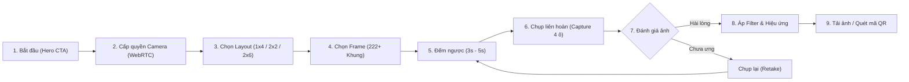
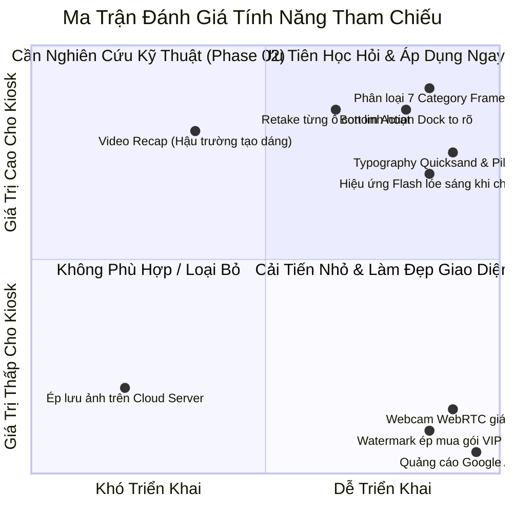

# 1998 TEAM — PHOTOBOOTH REFERENCE RESEARCH
## Báo Cáo Nghiên Cứu Chuyên Sâu UI/UX — Phase 01: BeautyPlus & PhotoXinhh

> **Tài liệu:** Nghiên cứu & Phân tích UI/UX Đối Thủ / Sản Phẩm Tham Chiếu  
> **Phiên bản baseline 1998 TEAM:** v1.6.6 Build 166 (Codebase giữ nguyên trạng thái đóng băng, không chỉnh sửa mã nguồn)  
> **Ngày thực hiện:** 01/11/2026  
> **Phạm vi:** Nghiên cứu tham chiếu sản phẩm Web/App Photobooth thực tế (BeautyPlus & PhotoXinhh / FreeHihi)  
> **Mục tiêu:** Rút tỉa những giá trị cốt lõi về trải nghiệm người dùng (UX), thiết kế giao diện (UI), cấu trúc luồng thao tác (Workflow) nhằm chuẩn bị cơ sở dữ liệu định hướng cho lộ trình nâng cấp 1998 TEAM Photobooth.

---

## MỤC LỤC

1. [Tổng Quan Sản Phẩm Tham Chiếu A — BeautyPlus AI Photo Booth](#1-t%E1%BB%95ng-quan-s%E1%BA%A3n-ph%E1%BA%A9m-tham-chi%E1%BA%BFu-a--beautyplus-ai-photo-booth)
2. [Tổng Quan Sản Phẩm Tham Chiếu B — PhotoXinhh / FreeHihi](#2-t%E1%BB%95ng-quan-s%E1%BA%A3n-ph%E1%BA%A9m-tham-chi%E1%BA%BFu-b--photoxinhh--freehihi)
3. [Bộ Sưu Tập Screenshot Minh Họa Chuyên Sâu (Visual Evidence)](#3-b%E1%BB%99-s%C6%B0u-t%E1%BA%ADp-screenshot-minh-h%E1%BB%8Da-chuy%C3%AAn-s%C3%A2u-visual-evidence)
4. [Phân Tích Chi Tiết 6 Khía Cạnh Trải Nghiệm & Giao Diện](#4-ph%C3%A2n-t%C3%ADch-chi-ti%E1%BA%BFt-6-kh%C3%ADa-c%E1%BA%A1nh-tr%E1%BA%A3i-nghi%E1%BB%87m--giao-di%E1%BB%87n)
   - [A. Visual Design (Màu sắc, Typography, Card, Button, Layout)](#a-visual-design)
   - [B. Photobooth Workflow (Từ Bắt Đầu Đến Tải Ảnh/In)](#b-photobooth-workflow)
   - [C. Camera Experience (Live Preview, Tỷ Lệ, Phản Hồi Khi Chụp)](#c-camera-experience)
   - [D. Frame Experience (Thư Viện Khung, Phân Loại, Cá Nhân Hóa)](#d-frame-experience)
   - [E. User Experience (Công Thái Học, Màn Hình Cảm Ứng, Giảm Tải Nhận Thức)](#e-user-experience)
   - [F. Brand Identity (Bản Sắc Thương Hiệu, Yếu Tố Viral & Cảm Xúc)](#f-brand-identity)
5. [Bảng So Sánh Đối Đầu (Head-to-Head Comparison)](#5-b%E1%BA%A3ng-so-s%C3%A1nh-%C4%91%E1%BB%91i-%C4%91%E1%BA%A7u-head-to-head-comparison)
6. [Ma Trận Điểm Mạnh & Hạn Chế (Strengths & Weaknesses)](#6-ma-tr%E1%BA%ADn-%C4%91i%E1%BB%83m-m%E1%BA%A1nh--h%E1%BA%A1n-ch%E1%BA%BF-strengths--weaknesses)
7. [Đối Chiếu Chi Tiết Với 1998 TEAM Photobooth v1.6.6](#7-%C4%91%E1%BB%91i-chi%E1%BA%BFu-chi-ti%E1%BA%BFt-v%E1%BB%9Bi-1998-team-photobooth-v166)
   - [Phân loại 4 nhóm ý tưởng](#ph%C3%A2n-lo%E1%BA%A1i-4-nh%C3%B3m-%C3%BD-t%C6%B0%E1%BB%9Fng)
   - [Đối chiếu từng module chức năng](#%C4%91%E1%BB%91i-chi%E1%BA%BFu-t%E1%BB%ABng-module-ch%E1%BB%A9c-n%C4%83ng)
8. [Các Điểm Khác Biệt Cốt Lõi 1998 TEAM Cần Tuyệt Đối Bảo Vệ](#8-c%C3%A1c-%C4%91i%E1%BB%83m-kh%C3%A1c-bi%E1%BB%87t-c%E1%BB%91t-l%C3%B5i-1998-team-c%E1%BA%A7n-tuy%E1%BB%87t-%C4%91%E1%BB%91i-b%E1%BA%A3o-v%E1%BB%87)
9. [Đề Xuất Các Hạng Mục Nghiên Cứu Thêm Cho Phase 02](#9-%C4%91%E1%BB%81-xu%E1%BA%A5t-c%C3%A1c-h%E1%BA%A1ng-m%E1%BB%A5c-nghi%C3%AAn-c%E1%BB%A9u-th%C3%AAm-cho-phase-02)

---

## 1. TỔNG QUAN SẢN PHẨM THAM CHIẾU A — BEAUTYPLUS AI PHOTO BOOTH

- **Website mục tiêu:** `https://www.beautyplus.com/vi/photo-booth`
- **Đơn vị chủ quản / Nền tảng:** Pixocial Technology / Meitu Global Network.
- **Kiến trúc công nghệ quan sát được:** Next.js (React), Webpack chunks, i18n localization tiếng Việt (`vi.page.js`, `vi.common.js`), Schema.org HowTo structured data.

### Định Vị Sản Phẩm (Product Positioning)
BeautyPlus Photo Booth là một tính năng web-based freemium nằm trong hệ sinh thái chỉnh sửa ảnh & tạo ảnh AI của BeautyPlus. Sản phẩm mô phỏng lại trải nghiệm chụp ảnh 4 ô Hàn Quốc (Life4Cuts / Photoism) ngay trên trình duyệt máy tính, laptop hoặc điện thoại, phục vụ người dùng cá nhân muốn có ảnh photobooth "ảo" tại nhà mà không cần ra studio hay kiosk chuyên nghiệp.

### Đối Tượng Người Dùng Mục Tiêu (Target Audience)
- Khách hàng trẻ tuổi, học sinh - sinh viên, nữ giới từ 15–28 tuổi.
- Người dùng mạng xã hội (TikTok, Instagram) chuộng xu hướng selfie phong cách Y2K, retro Hàn Quốc.
- Người dùng muốn thử nghiệm pose dáng và tạo ảnh ghép strip trước khi ra tiệm chụp thật.

### Giá Trị Cốt Lõi & Hạn Chế
- **Điểm mạnh chính:**
  - Tích hợp sâu các thuật toán AI làm đẹp (Smart Beauty, Face Retouch, Skin Smoothing, Eye Enlarge, Makeup Filters).
  - Giao diện trau chuốt, hiện đại, mang tính thương mại quốc tế cao.
  - Tương thích tốt trên cả desktop và mobile web thông qua giao diện co giãn linh hoạt.
- **Hạn chế chính:**
  - Bản chất là giải pháp Web Cloud Freemium: thường xuyên yêu cầu người dùng đăng nhập, nâng cấp gói VIP trả phí để mở khóa bộ lọc cao cấp hoặc gỡ hình mờ (watermark).
  - Phụ thuộc hoàn toàn vào webcam trình duyệt (chất lượng hình ảnh thấp, phụ thuộc cảm biến laptop/điện thoại, méo góc rộng).
  - Hoàn toàn không có khả năng kết nối thiết bị ngoại vi chuyên dụng (máy ảnh cơ DSLR/Mirrorless, đèn studio strobe, máy in nhiệt dye-sublimation).

---

## 2. TỔNG QUAN SẢN PHẨM THAM CHIẾU B — PHOTOXINHH / FREEHIHI

- **Website mục tiêu:** `https://photo.freehihi.com/`
- **Ứng dụng trực tiếp:** `https://photo.freehihi.com/app`
- **Kiến trúc công nghệ quan sát được:** Vue 3 (Composition API), Vite, Ant Design Vue (`vendor-antd`), Quicksand Google Webfont, HTML5 Canvas 2D engine, Laravel backend REST API (`/api/categories`, `/api/images`, `/api/upload`), Google AdSense monetization.

### Định Vị Sản Phẩm (Product Positioning)
PhotoXinhh (FreeHihi) là ứng dụng web photobooth trực tuyến thuần Việt, định vị là công cụ "Chụp 4 ô lấy liền như ngoài tiệm" hoàn toàn miễn phí, không cần cài app, không watermark, bảo mật tại trình duyệt. Sản phẩm giải quyết trực tiếp nhu cầu "đu trend" photobooth Hàn Quốc của giới trẻ Việt Nam với kho frame bắt trend nội địa hóa cao.

### Đối Tượng Người Dùng Mục Tiêu (Target Audience)
- Học sinh, sinh viên các trường đại học tại Việt Nam (có riêng danh mục Frame Đại Học: NEU, FTU, Bách Khoa, v.v.).
- Fan Kpop / Vpop (danh mục Frame IDOL Hoạt Họa, Chụp Cùng Idol).
- Các cặp đôi, nhóm bạn trẻ muốn chụp ảnh kỷ niệm phong cách dễ thương, vui tươi.

### Giá Trị Cốt Lõi & Hạn Chế
- **Điểm mạnh chính:**
  - **Zero-barrier to entry:** Người dùng chỉ cần mở trình duyệt là có thể chụp ngay, không cần đăng ký tài khoản, không chèn watermark ép trả tiền.
  - **Kho Frame khổng lồ bắt trend nội địa:** 222 frame được phân loại khoa học thành 7 nhóm chủ đề gần gũi với văn hóa giới trẻ Việt Nam.
  - **Tính năng Video Recap:** Tự động ghi lại các đoạn clip ngắn trong quá trình tạo dáng và ghép thành video recap vui nhộn.
  - **Giao diện thân thiện cảm ứng:** Màu hồng pastel, font chữ bo tròn đáng yêu (Quicksand), nút bấm to, phản hồi âm thanh chụp màn trập sống động (`/shutter.mp3`).
- **Hạn chế chính:**
  - Nguồn thu chủ yếu dựa vào quảng cáo Google AdSense, xuất hiện banner gây gián đoạn thị giác.
  - Dùng camera trình duyệt (WebRTC `getUserMedia`), giới hạn ở độ phân giải 720p/1080p của webcam, không có khả năng điều khiển thông số phơi sáng chuyên sâu.
  - Không có luồng in ấn phần cứng (chỉ hỗ trợ tải file ảnh PNG về máy hoặc quét mã QR qua điện thoại).

---

## 3. BỘ SƯU TẬP SCREENSHOT MINH HỌA CHUYÊN SÂU (VISUAL EVIDENCE)

Toàn bộ các tài nguyên hình ảnh được thu thập trực tiếp từ phiên truy cập thực tế của hai nền tảng, lưu trữ chuẩn tại thư mục artifact hệ thống `research_screenshots` và đồng bộ vào `docs/research_screenshots/`.

### 3.1. Giao Diện BeautyPlus Web Photobooth

| Hình ảnh chụp thực tế | Mô tả & Chú thích phân tích chuyên sâu |
| :--- | :--- |
|  | **BeautyPlus Desktop Landing & Editor Hero:**<br>• Tông màu chủ đạo: Tương phản giữa nền tối slate `#151515` và bề mặt trắng `#ffffff` với điểm nhấn hồng neon `#FF528F`.<br>• Tiêu đề H1 rõ ràng: *"Photo Booth Online Web – Chụp ảnh photo booth miễn phí ngay tại nhà"*.<br>• Nút CTA bo tròn dạng pill (`rounded-full`) màu hồng nổi bật kích thích hành động "Bắt đầu". |
|  | **BeautyPlus Hero Banner Showcase:**<br>• Minh họa trực quan dải ảnh 4 ô dọc (1x4 Vertical Strip) với hiệu ứng bóng đổ đổ bóng sâu, tạo cảm giác như ảnh in giấy thật.<br>• Tích hợp nhãn dán sticker phong cách Y2K và logo thương hiệu ở chân dải ảnh. |
|  | **BeautyPlus Feature Grid:**<br>• Trình bày quy trình 3 bước (HowTo): (1) Chụp 4 tấm liên tiếp đếm ngược 3s, (2) Chọn sticker & khung viền, (3) Xuất ảnh.<br>• Các thẻ card bo góc 16px viền chuyển sắc nhẹ (Gradient border), typography font *Outfit* hiện đại. |
|  | **BeautyPlus Mobile Responsive:**<br>• Giao diện co giãn chuẩn mobile màn hình dọc.<br>• Nút hành động dồn xuống vị trí ngón tay cái dễ bấm, tối ưu thao tác một tay. |

---

### 3.2. Giao Diện PhotoXinhh / FreeHihi

| Hình ảnh chụp thực tế | Mô tả & Chú thích phân tích chuyên sâu |
| :--- | :--- |
|  | **PhotoXinhh Landing Page (Desktop):**<br>• Tông màu chủ đạo: Hồng phấn pastel ngọt ngào (`#fff5f7`, `#ff80a1`, `#fdf2f8`).<br>• Typography: Font *Quicksand* mềm mại, bo tròn các nét chữ, tạo cảm giác vô cùng thân thiện với giới trẻ.<br>• Thông điệp rõ ràng: *"Photobooth Online Miễn Phí - Khung Hot Trend 2026 - Không cài app - Không watermark"*. |
|  | **PhotoXinhh Hero Section:**<br>• Các dải ảnh 4 ô mẫu được xếp so le có góc xoay nhẹ (tilted angle), tạo chiều sâu thị giác và sự sống động.<br>• Nút "Chụp ảnh ngay" màu hồng đậm hiệu ứng đổ bóng mềm (Soft pink drop shadow). |
|  | **PhotoXinhh Sample Templates Showcase:**<br>• Trình bày thư viện frame mẫu đa dạng: Khung hoạt họa, khung idol, khung retro cổ điển.<br>• Minh họa rõ các bố cục: Dải 4 ô dọc (1x4 strip), ô vuông (2x2 grid), khung ngang chữ nhật. |
|  | **PhotoXinhh Direct Web Application (`/app`):**<br>• Khu vực trung tâm: Khung ngắm camera trực tiếp kết hợp khung viền thời gian thực.<br>• Bố cục 3 cột cân xứng: Cột trái (chọn Layout & Frame), cột giữa (Live Stage), cột phải (chọn Filter & Hiệu ứng).<br>• Dưới đáy: Action dock với nút chụp tròn lớn và nút chụp lại (Retake). |
|  | **PhotoXinhh App Navbar & Branding:**<br>• Logo hoa anh đào 🌸 dễ thương, thanh điều hướng tinh gọn gồm: "Hướng dẫn làm frame", "Đóng góp cộng đồng", "Ủng hộ/Donate".<br>• Icon trạng thái rõ ràng, không làm rối mắt người dùng. |
|  | **PhotoXinhh Live View Stage:**<br>• Khung hình camera tỷ lệ chuẩn ăn khớp với ô trống của Frame PNG.<br>• Đèn tín hiệu ảo, bộ đếm giây hiển thị to rõ ràng ở giữa màn hình trước mỗi shot chụp. |
|  | **PhotoXinhh Frame Selector Panel:**<br>• Thẻ chuyển danh mục dạng chip ngang bo tròn (`rounded-full`).<br>• Lưới thumbnail frame tải nhanh với định dạng `.webp` độ phân giải 480px, hiển thị tức thì khi click. |
|  | **PhotoXinhh Filters & Settings Panel:**<br>• Danh sách bộ lọc màu: *Classic, Dazz Instant, Vintage grain, Film tone*.<br>• Ghi chú hướng dẫn rõ ràng: *"Hiệu ứng: Chụp xong mới áp dụng bộ lọc để đảm bảo tốc độ"*. |
|  | **PhotoXinhh Action Dock:**<br>• Nút chụp trung tâm đường kính lớn, viền đôi nổi bật.<br>• Nút Retake (`retry.png`) đặt ngay cạnh, cho phép chụp lại nhanh chóng.<br>• Tùy chọn chuyển đổi camera trước/sau hoặc lật gương (Mirror toggle). |
|  | **PhotoXinhh Mobile Viewport:**<br>• Tối ưu cảm ứng di động hoàn hảo: Các thanh công cụ chuyển thành thanh cuộn ngang dưới đáy.<br>• Khung chụp tự căn giữa không bị tràn màn hình. |

---

## 4. PHÂN TÍCH CHI TIẾT 6 KHÍA CẠNH TRẢI NGHIỆM & GIAO DIỆN

### A. VISUAL DESIGN

#### 1. Hệ Bảng Màu (Color Palette)
- **PhotoXinhh:**
  - **Màu nền chủ đạo:** `#FFF5F7` (Hồng phấn kem siêu nhạt, chiếm 16.3% diện tích điểm ảnh).
  - **Màu nhấn thương hiệu (Primary Accent):** `#FF80A1` đến `#FF528F` (Hồng san hô ngọt ngào, tạo cảm giác tươi tắn, kích thích sự hứng khởi).
  - **Màu phụ trợ (Secondary/Surfaces):** `#FDF2F8`, `#FCE7F3` (Các sắc thái hồng pastel tạo khối thẻ card mềm mại).
  - **Màu chữ (Typography):** Xám than ấm `#2D2D2D` và `#5C5C5C`, độ tương phản đạt chuẩn WCAG AA trên nền pastel mà không bị gắt như màu đen thuần `#000000`.
- **BeautyPlus:**
  - **Màu nền:** Kết hợp giữa nền trắng `#FFFFFF` (58.5%) và nền tối slate sang trọng `#151515`, `#101010`.
  - **Màu nhấn thương hiệu:** Magenta/Neon Pink `#FF528F`, `#FF6DA2`, `#FF7EAC` pha trộn chuyển sắc (Gradient).
  - **Màu thẻ & viền:** Sử dụng viền chuyển màu gradient siêu mảnh (`photo-booth_gradient-border`) tạo phong cách công nghệ cao cấp (High-tech Glamour).

#### 2. Nghệ Thuật Chữ (Typography)
- **PhotoXinhh:** Sử dụng font chữ **Quicksand** (Google Fonts) làm font chủ đạo (`font-family: Quicksand, system-ui, sans-serif`). Quicksand có đặc tính các đầu nét được bo tròn nhẹ (Rounded terminals), tạo cảm giác vui vẻ, trẻ trung, cực kỳ tương thích với concept "booth ảnh Hàn Quốc đáng yêu".
- **BeautyPlus:** Sử dụng bộ đôi font **Outfit** và **Inter** (`font-family: Outfit, var(--font-inter)`). Outfit là font Sans-serif hình học (Geometric Sans) mang hơi hướng hiện đại, chuẩn mực quốc tế, tạo vẻ chuyên nghiệp và cao cấp.

#### 3. Cấu Trúc Nút Bấm, Thẻ Card & Khối Điều Khiển (Components & Shapes)
- **Độ bo góc (Border Radius):**
  - Cả hai sản phẩm đều từ bỏ hoàn toàn các góc nhọn cứng nhắc (`0px` hay `4px`).
  - PhotoXinhh sử dụng hệ thống Tailwind bo góc mạnh mẽ: `rounded-2xl` (16px), `rounded-3xl` (24px) và `rounded-full` (9999px cho các nút bấm hình con nhộng - Pill buttons).
  - BeautyPlus sử dụng border-radius từ `12px` đến `20px` kết hợp các nút bấm pill bo tròn hoàn hảo.
- **Thẻ Card & Đổ Bóng (Elevation & Shadows):**
  - Đổ bóng khuếch tán cực mềm: `box-shadow: 0 20px 25px -5px rgba(0, 0, 0, .05)`, không dùng bóng cứng đen kịt.
  - Các khối thẻ chứa frame mẫu được đặt trong khung viền trắng hoặc hồng nhạt mỏng `1px - 2px`, tạo hiệu ứng bồng bềnh (Floating Card Effect).
- **Bộ Điều Khiển Lựa Chọn (Dropdowns & Chips):**
  - Thay vì sử dụng thẻ `<select>` truyền thống gây nhàm chán và khó bấm trên màn hình cảm ứng, cả hai nền tảng đều chuyển thành **Thanh cuộn thẻ chip ngang (Horizontal Scrollable Chips)**. Người dùng có thể nhìn thấy ngay các lựa chọn mà không phải bấm mở dropdown.

---

### B. PHOTOBOOTH WORKFLOW

Quy trình trải nghiệm người dùng được chuẩn hóa theo mô hình tuyến tính cực kỳ trực quan:



#### Chi Tiết Từng Bước Thực Thi:
1. **Khởi đầu (Landing):** Nút CTA lớn nổi bật ở trang chủ ("Bắt đầu" hoặc "Chụp ảnh ngay"), người dùng không phải tìm kiếm hay qua các bước đăng ký rườm rà.
2. **Cấp quyền Camera:** Trình duyệt xin quyền `getUserMedia({ video: true, audio: false })`. Khi được cấp quyền, Live View kích hoạt ngay lập tức với chế độ phản chiếu gương (Mirror mode) mặc định.
3. **Lựa chọn Layout & Frame:** Người dùng chọn bố cục trước hoặc trong khi Live View đang chạy:
   - Dải 4 ô dọc (1x4 Vertical Strip).
   - Khung vuông 4 ô (2x2 Grid).
   - Dải ngang đôi (2x6 Double Strip).
   - Bố cục 5 tư thế sáng tạo (Custom 5-pose).
4. **Đếm ngược (Countdown Sequence):**
   - Đếm ngược hiển thị số kích thước lớn ngay giữa Live View: `3... 2... 1...`.
   - Có tùy chọn thời gian đếm: 3 giây (chụp nhanh, phong cách BeautyPlus) hoặc 5-10 giây (đủ thời gian tạo dáng nhóm bạn).
5. **Chụp hình (Capture Execution):**
   - Máy chụp tuần tự từng ô. Mỗi shot chụp đi kèm âm thanh màn trập chân thực (`shutter.mp3`) và hiệu ứng chớp trắng toàn màn hình (White flash overlay).
   - Ảnh chụp được đưa ngay vào vị trí ô tương ứng trên khung hình bên cạnh để người dùng quan sát tiến độ.
6. **Chụp lại (Retake Flow):**
   - PhotoXinhh hỗ trợ nút Retake nhanh với icon mũi tên xoay tròn (`retry.png`), cho phép xóa toàn bộ ảnh vừa chụp để bắt đầu chuỗi chụp mới mà không làm mất cài đặt frame đã chọn.
7. **Hậu kỳ & Áp dụng Bộ Lọc (Post-Processing & Filters):**
   - Sau khi chụp đủ 4 ảnh, hệ thống mới mở khóa bảng bộ lọc màu: *Classic, Dazz Instant, Vintage grain, Film tone*.
   - Việc trì hoãn xử lý filter sau khi chụp giúp GPU trình duyệt không bị quá tải khi đang Live View, đảm bảo đếm ngược mượt mà 60 FPS.
8. **Xuất thành phẩm (Export & Distribution):**
   - Canvas 2D vẽ ảnh nền frame PNG, chèn các ảnh con, áp filter và xuất file định dạng PNG độ nét cao.
   - Hiển thị song song: Nút tải file trực tiếp về máy tính và Mã QR Code trên màn hình để dùng điện thoại quét lấy ảnh ngay.

---

### C. CAMERA EXPERIENCE

- **Chế độ xem trực tiếp (Live Camera Preview):**
  - Mặc định kích hoạt tính năng **Lật gương hình ảnh (Mirror View)**: Đây là yếu tố sống còn cho photobooth, vì người chụp luôn có thói quen soi gương; nếu không lật gương, người dùng sẽ bị lúng túng khi chỉnh góc mặt hoặc vuốt tóc.
  - Tỷ lệ khung ngắm tự động thích ứng (Letterboxing / Crop) theo đúng tỷ lệ của ô con trong layout đã chọn, giúp người dùng canh trúng khung người mà không sợ bị cắt đầu hay mất tay khi vào ảnh chính.
- **Vị trí và công thái học của bộ điều khiển:**
  - Nút Shutter đặt tại vị trí trung tâm phía dưới cùng (Bottom Dock), kích thước lớn (đường kính > 64px), dễ dàng thao tác bằng ngón tay cái trên màn hình cảm ứng hoặc click chuột nhanh.
  - Các nút phụ trợ: Bật/tắt gương, chọn thời gian hẹn giờ (3s/5s/10s), chuyển đổi camera được xếp thành hàng ngang gọn gàng ngay dưới khung Live View.
- **Phản hồi tức thì khi chụp (Shutter Feedback):**
  - **Thị giác (Visual Feedback):** Một lớp phủ mờ màu trắng (Flash opacity 0.8 -> 0) chớp nhẹ trong 150ms tạo cảm giác như đèn studio lóe sáng.
  - **Thính giác (Audio Feedback):** Âm thanh tiếng màn trập cơ học "Tách - Xoạch" quen thuộc, xác nhận ảnh đã được chụp thành công.

---

### D. FRAME EXPERIENCE

#### 1. Thư Viện & Cấu Trúc Danh Mục Khung (Frame Architecture)
PhotoXinhh xây dựng một cấu trúc dữ liệu cực kỳ bài bản với **222 frame** chia làm 7 danh mục chuyên biệt:

```
Thư Viện Khung PhotoXinhh (222 Frames)
 ├── 1. Frame Cartoon (Chủ đề hoạt hình, Sanrio, Hello Kitty, Shin, Doraemon)
 ├── 2. Frame Basic (Khung viền tối giản trắng, đen, pastel phong cách Hàn Quốc)
 ├── 3. Frame Amazing ⭐️ (Các mẫu khung hot trend nổi bật nhất mạng xã hội)
 ├── 4. Frame Đại Học (Khung kỷ niệm gắn logo/tên trường: NEU, Bách Khoa, v.v.)
 ├── 5. Frame IDOL Hoạt Họa (Hình minh họa thần tượng chibi đáng yêu)
 ├── 6. Frame Sự Kiện (Chủ đề Giáng sinh, Năm mới, Valentine, Sinh nhật)
 └── 7. Frame Chụp Cùng Idol (Khung có sẵn hình nửa người của idol để chụp đôi)
```

#### 2. Trải Nghiệm Lựa Chọn & Xem Trước Khung
- Thumbnail của mỗi frame được tối ưu định dạng `.webp` với chiều rộng chuẩn 480px, nén dung lượng chỉ khoảng 15–40 KB, giúp việc cuộn lướt 222 frame mượt mà không bị giật lag.
- Khi người dùng nhấp chọn một frame mới, hệ thống cập nhật tức thời layer đè lên khung ngắm Live View và khu vực Preview mà **không làm gián đoạn luồng camera hay mất đi các ảnh đã chụp**.

#### 3. Khả Năng Cá Nhân Hóa (Personalization)
- Cho phép người dùng tải lên frame tự thiết kế của riêng mình (`/api/upload`).
- Hỗ trợ đổi màu viền nền cơ bản khi không sử dụng frame đồ họa phức tạp.
- Tùy chọn gắn sticker hoặc chèn ngày tháng chụp tự động ở góc dải ảnh.

---

### E. USER EXPERIENCE (UX)

#### 1. Số Bước Hoàn Thành (Frictionless Journey)
- Toàn bộ hành trình chỉ gói gọn trong **3 đến 4 thao tác chạm**:
  - `Chạm 1:` Bắt đầu & Chọn khung.
  - `Chạm 2:` Bấm chụp (Hệ thống tự động chạy hết chuỗi 4 shot).
  - `Chạm 3:` Chọn filter màu yêu thích.
  - `Chạm 4:` Bấm tải ảnh hoặc quét QR.
- Thời gian trung bình để một khách hàng hoàn tất một chu kỳ chụp chỉ từ **45 đến 75 giây**, cực kỳ phù hợp cho môi trường photobooth kiosk đông người chờ đợi.

#### 2. Thao Tác Trực Quan vs Thao Tác Gây Nhầm Lẫn
- **Rất trực quan:**
  - Bộ đếm thời gian số to kết hợp âm thanh đếm nhịp "tít... tít... tít" giúp người dùng luôn chủ động tư thế.
  - Live View phản chiếu gương chuẩn giúp tạo dáng tự nhiên.
  - Thẻ card và nút bấm có kích thước lớn, màu sắc phân biệt rõ ràng giữa nút chính (Primary) và nút phụ (Secondary).
- **Điểm gây nhầm lẫn quan sát được trên web tham chiếu:**
  - Trên PhotoXinhh: Nút "Retake" mặc định xóa toàn bộ 4 ảnh để chụp lại từ đầu. Nếu người dùng chỉ muốn chụp lại duy nhất bức ảnh thứ 3 bị nhắm mắt thì chưa hỗ trợ chọn từng ô riêng biệt (Slot-based Retake).
  - Banner quảng cáo Google AdSense xuất hiện ở chân trang hoặc cạnh bên đôi khi che mất các nút điều khiển trên màn hình nhỏ.

#### 3. Trải Nghiệm Màn Hình Cảm Ứng (Touchscreen Ergonomics)
- Mọi nút bấm đều đạt kích thước tối thiểu **48x48px** (vùng chạm vật lý), khoảng cách giữa các nút từ 12px đến 16px, ngăn chặn hoàn toàn việc chạm nhầm ngón tay.
- Hỗ trợ thao tác vuốt trượt (Swipe horizontal) trên thanh danh mục frame mượt mà.

---

### F. BRAND IDENTITY

#### 1. Ngôn Ngữ Nhận Diện Đặc Trưng
- **PhotoXinhh:** Xây dựng thương hiệu quanh biểu tượng hoa anh đào 🌸 và tên gọi gợi cảm xúc vui tươi *"FreeHihi"*. Toàn bộ ngôn ngữ copywriter đều mang tính thân thiện, gần gũi với tuổi học trò (VD: *"Frame mới sẽ được liên tục cập nhật ^^"*, *"Chụp 4 ô lấy liền như ngoài tiệm!"*).
- **BeautyPlus:** Nhận diện thương hiệu công nghệ làm đẹp toàn cầu với logo hình máy ảnh cách điệu cánh bướm chuyển sắc hồng - tím neon, định vị sự sang trọng, hiện đại và thời thượng.

#### 2. Yếu Tố Viral & Lưu Giữ Kỷ Niệm (Memorable Hooks)
- **Tính năng Video Recap:** PhotoXinhh tạo điểm nhấn độc đáo bằng cách cho phép người dùng xem lại đoạn video ngắn tổng hợp quá trình "hậu trường" tạo dáng nhí nhố của các bức ảnh. Đây là yếu tố cực kỳ đắt giá, kích thích người dùng tải về để đăng lên TikTok, Instagram Reels, tạo hiệu ứng lan tỏa tự nhiên (Organic Viral).
- Dải ảnh in ra mang đậm phong cách văn hóa photobooth Hàn Quốc: Viền trắng tinh khôi, góc bo tròn nhẹ, ngày tháng năm in nhỏ nhắn dưới đáy và mã QR kỷ niệm.

---

## 5. BẢNG SO SÁNH ĐỐI ĐẦU (HEAD-TO-HEAD COMPARISON)

| Tiêu chí so sánh | BeautyPlus Photo Booth | PhotoXinhh (FreeHihi) | 1998 TEAM Photobooth v1.6.6 (Hiện tại) |
| :--- | :--- | :--- | :--- |
| **Nền tảng triển khai** | Web Cloud SaaS (Next.js / React) | Web App thuần client (Vue 3 / Vite) | **Windows Native Desktop Kiosk** (PySide6 / Qt6) |
| **Thiết bị ghi hình** | Webcam máy tính / Camera điện thoại | Webcam máy tính / Camera điện thoại | **DSLR Nikon D780 vật lý qua SDK MAID3 Type0026** |
| **Chất lượng hình ảnh** | WebRTC nén (720p - 1080p mờ) | WebRTC nén (720p - 1080p) | **Full-frame 24.5 MP sắc nét quang học, xóa phông thực** |
| **Lấy nét & Nhận diện** | Xử lý AI nhận diện khuôn mặt cloud | Trình duyệt mặc định | **Unified Face/Eye AF thời gian thực (OpenCV + MediaPipe)** |
| **Thiết bị in ấn** | Không hỗ trợ in ấn | Không hỗ trợ in ấn | **Máy in nhiệt DNP DS-RX1HS chuyên nghiệp (Pacing, Presets)** |
| **Tính độc lập mạng** | Cần Internet 100% | Cần Internet để tải frame | **Chạy 100% Offline (Không phụ thuộc Internet, Local HTTP)** |
| **Thư viện Frame** | Ít mẫu, tập trung filter AI | **Cực lớn (222 frames, 7 danh mục)** | Hệ thống mẫu 1x4, 2x6, 4x6 tùy biến linh hoạt |
| **Tùy biến Layout** | Cố định dải 4 ô | **1x4 strip, 2x2 grid, 2x6, custom_5** | Dải đôi 2x6, Khung đơn 4x6, Strip dọc |
| **Hệ thống âm thanh** | Không có âm thanh cơ học | Có tiếng màn trập cơ (`shutter.mp3`) | **QSoundEffect độc lập, giọng nói tiếng Việt, WAV studio** |
| **Tính năng Video Recap**| Không có | **Có (Lưu clip ngắn tạo dáng)** | Chưa triển khai (Mới chỉ lưu chuỗi ảnh tĩnh) |
| **Tốc độ chụp & Delay** | Phụ thuộc mạng cloud | Nhanh, render canvas client | **Tức thời (Tethering USB PTP/WPD siêu tốc)** |
| **Chụp lại (Retake)** | Bắt đầu lại toàn bộ | Bấm nút Retry làm lại chuỗi | **Hỗ trợ chọn xem lại và chụp lại tại Kiosk Review** |
| **Chia sẻ di động** | Nâng cấp tài khoản / Tải file | **Mã QR Code hiển thị trên web** | **Mã QR trỏ về Local HTTP Hotspot không tốn data** |
| **Mô hình chi phí** | Freemium (Thu phí mở khóa / Watermark)| Miễn phí kèm banner AdSense | **Hệ thống thương mại độc quyền, Kiosk tự phục vụ** |
| **Typography chủ đạo** | Outfit & Inter | **Quicksand (Bo tròn, dễ thương)** | Segoe UI / System Sans-serif |

---

## 6. MA TRẬN ĐIỂM MẠNH & HẠN CHẾ (STRENGTHS & WEAKNESSES)



### Chi Tiết Phân Tích:

#### 1. BeautyPlus
- **Điểm mạnh (Strengths):**
  - Khả năng xử lý da mặt và bộ lọc màu AI làm đẹp vượt trội, che khuyết điểm da rất mịn.
  - Thiết kế đồ họa mẫu khung thời thượng, chuẩn thẩm mỹ Gen Z quốc tế.
  - Giao diện có chiều sâu nhờ viền gradient và đổ bóng tinh tế.
- **Hạn chế (Weaknesses):**
  - Quá nhiều rào cản thương mại (ép xem quảng cáo, ép trả phí để gỡ watermark).
  - Không phục vụ được môi trường kiosk sự kiện đông đúc vì thao tác web rườm rà.

#### 2. PhotoXinhh / FreeHihi
- **Điểm mạnh (Strengths):**
  - Kho 222 frame bắt trend cực nhanh, phân loại danh mục theo nhu cầu thực tế của giới trẻ Việt Nam.
  - Cực kỳ tinh gọn, không rào cản, người dùng vào là chụp ngay.
  - Trải nghiệm cảm ứng rất tốt nhờ typography Quicksand bo tròn và các nút bấm lớn.
  - Tính năng Video Recap mang lại cảm xúc lưu niệm tuyệt vời.
- **Hạn chế (Weaknesses):**
  - Giới hạn phần cứng của nền tảng web: Ảnh chụp webcam bị hạt, mờ khi thiếu sáng.
  - Quảng cáo AdSense làm giảm đi độ sang trọng và tính chuyên nghiệp.
  - Thiếu hệ thống quản lý in nhiệt vật lý và giám sát vận hành phần cứng.

---

## 7. ĐỐI CHIẾU CHI TIẾT VỚI 1998 TEAM PHOTOBOOTH v1.6.6

Sau khi khảo sát chuyên sâu hai sản phẩm tham chiếu, toàn bộ các ý tưởng và phát hiện được đối chiếu trực tiếp với phần mềm **1998 TEAM Photobooth v1.6.6 Build 166** và phân loại nghiêm ngặt theo 4 nhóm định hướng:

### Phân Loại 4 Nhóm Ý Tưởng

```
┌────────────────────────────────────────────────────────────────────────┐
│ PHÂN LOẠI ĐỊNH HƯỚNG Ý TƯỞNG CHO 1998 TEAM PHOTOBOOTH                  │
├────────────────────────────────┬───────────────────────────────────────┤
│ (1) NÊN HỌC HỎI                │ (2) CÓ THỂ CẢI TIẾN                   │
│ • Phân loại danh mục Frame     │ • Bố cục Action Bar dưới đáy          │
│ • Typography mềm mại           │ • Hiệu ứng Flash trắng khi chụp       │
│ • Video Recap hậu trường       │ • Chế độ chọn Layout linh hoạt        │
│ • Nút chụp lại (Retake) to     │ • Thẻ chip chuyển danh mục            │
├────────────────────────────────┼───────────────────────────────────────┤
│ (3) KHÔNG PHÙ HỢP              │ (4) CHƯA ĐỦ DỮ LIỆU ĐÁNH GIÁ          │
│ • Quảng cáo banner AdSense     │ • Render Video Recap trên CPU Kiosk   │
│ • Watermark & khóa gói VIP     │ • Tự động upload frame cộng đồng      │
│ • Phụ thuộc Web Cloud Server   │ • Remote Camera Trigger qua WebRTC    │
│ • Dùng camera webcam mờ rẻ     │                                       │
└────────────────────────────────┴───────────────────────────────────────┘
```

---

### Đối Chiếu Từng Module Chức Năng

#### 1. Module Camera & Live View
- **Hiện trạng 1998 TEAM v1.6.6:**
  - Sử dụng ống kính & cảm biến Full-frame Nikon D780 qua giao tiếp USB tethering (Nikon MAID3 Type0026 SDK + WPD backend).
  - Tích hợp bộ điều khiển lấy nét khuôn mặt/mắt hợp nhất (`FaceEyeAFController`) sử dụng OpenCV Haar Cascade & MediaPipe.
  - Khung ngắm hiển thị qua `LiveViewport` hỗ trợ vẽ bounding box và điểm nét.
- **Đối chiếu & Học hỏi:**
  - **Nên học hỏi:** Cơ chế lật gương mặc định (Mirror Mode) và khung định vị tư thế (Pose Guide Silhouette) của các app photobooth giúp khách hàng không bị lóng ngóng khi nhìn vào màn hình Kiosk lớn.
  - **Có thể cải tiến:** Bổ sung hiệu ứng **Flash nháy trắng màn hình (Screen White Flash)** kéo dài 150ms trên `LiveViewport` khi Nikon D780 kích hoạt trập, tạo phản hồi thị giác rõ rệt cho khách đứng chụp từ xa.
  - **Điểm giữ nguyên:** Tuyệt đối giữ nguyên luồng Live View độ phân giải cao và cơ chế AF tracking thực của Nikon D780, không thay bằng webcam trình duyệt.

#### 2. Module Countdown & Capture
- **Hiện trạng 1998 TEAM v1.6.6:**
  - Module đếm ngược gắn trong `KioskPage`, kích hoạt chuỗi chụp tuần tự.
  - Tích hợp hệ thống âm thanh độc lập `StudioAudioManager` (PySide6 `QSoundEffect`) phát giọng đếm tiếng Việt và âm thanh trập cơ khí.
- **Đối chiếu & Học hỏi:**
  - **Nên học hỏi:** Giao diện số đếm ngược cần thiết kế số to, bo tròn theo phong cách Quicksand, có hiệu ứng nảy nhẹ (Pulse animation) theo từng giây để khách dễ chú ý.
  - **Có thể cải tiến:** Cho phép chọn trước thời gian đếm ngược (3 giây, 5 giây hoặc 8 giây) ngay trên màn hình Kiosk trước khi bấm bắt đầu, phục vụ các nhóm chụp đông người cần nhiều thời gian ổn định vị trí.

#### 3. Module Frame Designer & Thư Viện Khung
- **Hiện trạng 1998 TEAM v1.6.6:**
  - Quản lý frame qua danh sách template phẳng tải trong `_load_frame_options()`, phân trang bằng hai nút Next/Prev đơn giản.
  - Khung hình chủ yếu hiển thị dạng danh sách lướt qua lại.
- **Đối chiếu & Học hỏi:**
  - **Nên học hỏi:** Áp dụng mô hình **Phân loại danh mục theo Tab/Chip** của PhotoXinhh (7 danh mục: Basic, Cartoon, Đại học, Sự kiện, Idol, v.v.). Việc gom nhóm 100+ frame theo chủ đề giúp khách hàng tại Kiosk tìm đúng khung mong muốn chỉ trong 5 giây, thay vì phải bấm Next 20 lần qua từng trang.
  - **Có thể cải tiến:** Hiển thị số lượng frame trong từng danh mục và đánh dấu nhãn `HOT` hoặc `NEW` trên các khung mới cập nhật.

#### 4. Module Gallery & Xem Lại Ảnh (Review / Retake)
- **Hiện trạng 1998 TEAM v1.6.6:**
  - Hỗ trợ màn hình Review sau khi chụp đủ các slot, hiển thị ảnh ghép thành phẩm, có nút In ảnh (`_print_composite`) và nút Chụp lại toàn bộ (`_retake_session`).
- **Đối chiếu & Học hỏi:**
  - **Nên học hỏi:** Thiết kế nút Retake to, rõ ràng với icon mũi tên xoay tròn trực quan như `retry.png` của PhotoXinhh.
  - **Có thể cải tiến:** Bổ sung tính năng **Slot Retake (Chụp lại từng ô đơn lẻ)**. Nếu khách chụp chuỗi 4 tấm nhưng tấm thứ 3 bị nhắm mắt, khách có quyền bấm trực tiếp vào ô số 3 để chụp lại đúng tấm đó mà không phải chụp lại cả 4 tấm từ đầu. Đây là cải tiến vượt bậc so với cả PhotoXinhh lẫn BeautyPlus.
  - **Nghiên cứu thêm:** Tính năng **Video Recap (Hậu trường tạo dáng)** của PhotoXinhh cực kỳ hấp dẫn. Nếu 1998 TEAM có thể lưu chuỗi frame Live View thành clip ngắn 5 giây kèm nhạc nền để khách tải về cùng ảnh in, đây sẽ là vũ khí cạnh tranh độc quyền.

#### 5. Module In Ấn (Printing Pipeline)
- **Hiện trạng 1998 TEAM v1.6.6:**
  - Đã được làm cứng (Hardening) với `PrintPreset` theo từng model máy in nhiệt (DNP DS-RX1HS, Citizen, Hiti).
  - Có cấu hình Safety Margin (hỗ trợ mức 98% chống cắt lẹm mép giấy), kiểm tra hướng giấy tự động và cơ chế giãn nhiệt (Thermal Pacing) bảo vệ đầu in.
- **Đối chiếu & Học hỏi:**
  - **Khác biệt hoàn toàn:** Cả BeautyPlus và PhotoXinhh đều là phần mềm web thuần túy, hoàn toàn không có module in ấn vật lý.
  - **Điểm giữ nguyên:** Module Printing của 1998 TEAM vượt trội hoàn toàn so với hai sản phẩm tham chiếu và là giá trị kinh doanh cốt lõi của Photobooth dịch vụ. Cần bảo vệ tuyệt đối luồng in ấn ổn định hiện có.

#### 6. Module Chia Sẻ QR Code (QR Sharing)
- **Hiện trạng 1998 TEAM v1.6.6:**
  - Tích hợp máy chủ HTTP cục bộ (`server.py`) phát mã QR trên màn hình Kiosk (`_show_qr_dialog`). Khách dùng điện thoại quét mã để tải ảnh gốc trực tiếp qua mạng WiFi nội bộ không cần kết nối Internet ra ngoài.
- **Đối chiếu & Học hỏi:**
  - **Nên học hỏi:** Giao diện hộp thoại QR Code của PhotoXinhh rất thoáng đãng, có hình minh họa điện thoại quét mã và dòng chữ hướng dẫn ngắn gọn: *"Mở camera điện thoại quét mã để lấy ảnh gốc & video recap"*.
  - **Điểm giữ nguyên:** Bảo vệ cơ chế truyền file **Local HTTP Offline** của 1998 TEAM: Tốc độ tải về cực nhanh (1–2 giây cho file ảnh 10MB), bảo mật tuyệt đối dữ liệu khách hàng, không lo rò rỉ ảnh cá nhân lên các dịch vụ đám mây công cộng.

#### 7. Module Cài Đặt (Settings & Admin)
- **Hiện trạng 1998 TEAM v1.6.6:**
  - Hệ thống `SettingsPage` quản lý toàn bộ tham số phần cứng: Cấu hình cổng kết nối Nikon D780, chọn máy in, âm lượng studio, độ an toàn in ấn, Face AF.
- **Đối chiếu & Học hỏi:**
  - Cả hai đối thủ tham chiếu không có giao diện Admin kiosk vì là sản phẩm tiêu dùng cá nhân. 1998 TEAM cần duy trì cơ chế bảo vệ bằng mật khẩu quản trị viên để nhân viên vận hành cấu hình máy an toàn tại sự kiện.

---

## 8. CÁC ĐIỂM KHÁC BIỆT CỐT LÕI 1998 TEAM CẦN TUYỆT ĐỐI BẢO VỆ

Trong quá trình học hỏi các ý tưởng xuất sắc về UI/UX từ BeautyPlus và PhotoXinhh, 1998 TEAM phải kiên định bảo vệ các giá trị công nghệ nền tảng tạo nên vị thế dẫn đầu trong phân khúc Kiosk chuyên nghiệp:

1. **Chất lượng hình ảnh quang học đẳng cấp studio (Nikon D780 DSLR):**
   - Không thỏa hiệp chất lượng bằng cách chuyển sang webcam hay camera USB giá rẻ. Cảm biến Full-frame và ống kính khẩu lớn tạo độ sâu trường ảnh thực (Optical Bokeh), chi tiết sợi tóc và màu da chân thực mà không một thuật toán giả lập web nào có thể thay thế.
2. **Khả năng vận hành độc lập 100% Offline (Zero-Cloud Dependency):**
   - Tại các trung tâm thương mại, tiệc cưới, hội trường hay sự kiện dã ngoại, sóng 4G/WiFi thường xuyên bị nghẽn. 1998 TEAM hoạt động hoàn toàn độc lập, từ khâu chụp ảnh, ghép frame, in nhiệt đến phát WiFi hotspot nội bộ cho khách tải ảnh, không bao giờ lo sập server đám mây.
3. **Quy trình in nhiệt thăng hoa công nghiệp (Industrial Dye-Sub Printing):**
   - Bản in ra khô ngay, phủ màng bảo vệ chống nước, chống bám vân tay và có độ bền màu trên 50 năm qua máy in chuyên dụng DNP DS-RX1HS. Đây là sản phẩm vật lý cầm tay mà khách hàng sẵn sàng chi trả dịch vụ.
4. **Hệ thống âm thanh Studio đa kênh đồng bộ:**
   - Sử dụng âm thanh thực tế với giọng đọc tiếng Việt thân thiện và âm thanh cơ học chuẩn studio, tạo sự tương tác trực tiếp với khách hàng trước ống kính.
5. **Độ ổn định và an toàn của hệ thống Kiosk Windows Native:**
   - Ứng dụng native biên dịch Qt6/PySide6 không bị ảnh hưởng bởi lỗi crash bộ nhớ trình duyệt (Out-of-memory Canvas), không bị chặn bởi pop-up hay tiện ích chặn quảng cáo, bảo đảm hoạt động liên tục 24/7.

---

## 9. ĐỀ XUẤT CÁC HẠNG MỤC NGHIÊN CỨU THÊM CHO PHASE 02

Dựa trên kết quả nghiên cứu Phase 01, đề xuất người dùng xem xét các hướng nghiên cứu sâu hơn trong Phase 02 (chỉ thực hiện sau khi có phê duyệt chính thức):

1. **Thiết kế Thư Viện Token UI/UX (Design Tokens) cho Màn Hình Cảm Ứng Kiosk:**
   - Nghiên cứu áp dụng font chữ bo tròn thân thiện (tương tự Quicksand) cho chế độ Kiosk Mode, kết hợp hệ thống màu pastel nhẹ nhàng tạo cảm giác thư giãn cho khách chụp.
   - Chuẩn hóa hệ thống bo góc (`16px`, `24px`, `Pill 9999px`) và độ nổi của thẻ card.
2. **Kiến Trúc Phân Nhóm Thư Viện Frame (Frame Category Architecture):**
   - Thiết kế cấu trúc thư mục hoặc file cấu hình JSON cho phép quản trị viên tự do tạo các nhóm danh mục frame (VD: `category: "Hoạt Hình"`, `category: "Kỷ Niệm"`, `category: "Tối Giản"`).
   - Thiết kế thanh cuộn thẻ chip ngang trên giao diện Kiosk để người dùng lọc frame tức thì.
3. **Nghiên Cứu Khả Thi Kỹ Thuật Tính Năng Video Recap:**
   - Đánh giá khả năng trích xuất luồng buffer Live View trong thời gian đếm ngược (30 frame/giây) và dùng thư viện `OpenCV VideoWriter` hoặc `FFmpeg` ngầm để ghép thành video MP4 ngắn (3–5 giây) với độ phân giải 1080p.
   - Đảm bảo việc ghi video ngầm không gây tụt khung hình Live View hoặc ảnh hưởng đến tốc độ chụp của Nikon D780.
4. **Cơ Chế Slot-based Retake (Chụp lại từng ô con):**
   - Thiết kế UX cho phép khách hàng tại trang Review chạm vào bất kỳ ô ảnh nào trong 4 ô để chụp lại riêng ô đó, giúp tiết kiệm thời gian tối đa cho khách hàng và giảm hao phí giấy in.

---

> **KẾT THÚC BÁO CÁO NGHIÊN CỨU PHASE 01.**  
> *Báo cáo này được lập để phục vụ công tác nghiên cứu định hướng chiến lược UI/UX. Toàn bộ mã nguồn và bản build v1.6.6 Build 166 được giữ nguyên trạng thái đóng băng.*
