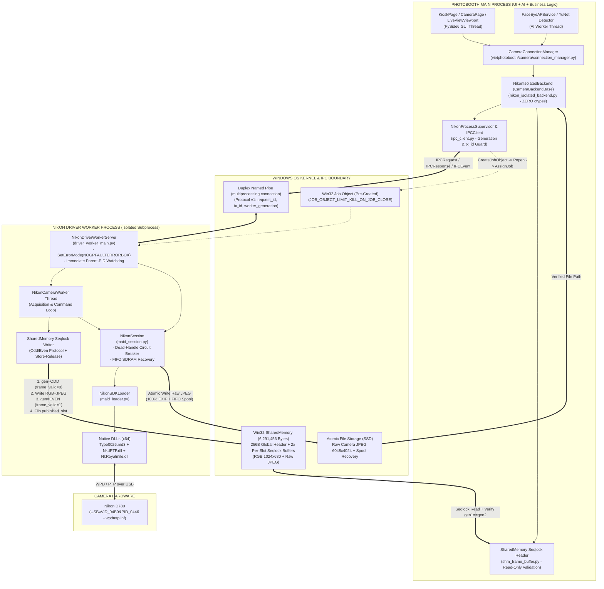
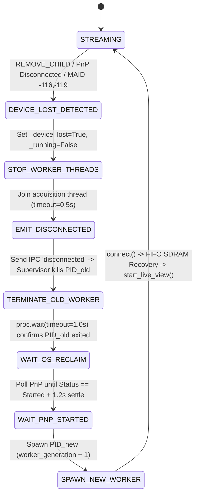

# THIẾT KẾ KIẾN TRÚC HOÀN CHỈNH (FINAL REVIEW): NIKON D780 PROCESS-ISOLATED DRIVER WORKER

- **Tài liệu:** Architecture Design Document (ADD) — **FINAL READ-ONLY ARCHITECTURE REVIEW**
- **Workspace:** `C:\Users\Admin\Documents\photobooth`
- **Branch:** `feature/v2.0.0-photobooth` (`HEAD: 08bfb13`)
- **Baseline bảo toàn:** `v2.0.1 Build 208` ([`vietphotobooth/version.py`](file:///C:/Users/Admin/Documents/photobooth/vietphotobooth/version.py))
- **Căn cứ thực nghiệm:**
  - [`docs/NIKON_D780_FULL_BATTERY_VERIFICATION_REPORT.md`](file:///C:/Users/Admin/Documents/photobooth/docs/NIKON_D780_FULL_BATTERY_VERIFICATION_REPORT.md)
  - [`docs/NIKON_D780_RECONNECT_FINAL_AUDIT.md`](file:///C:/Users/Admin/Documents/photobooth/docs/NIKON_D780_RECONNECT_FINAL_AUDIT.md)
- **Ràng buộc bất biến:**
  - Giữ nguyên Windows WPD/MTP driver (`wpdmtp.inf`, `USB\VID_04B0&PID_0446`).
  - Giữ nguyên Nikon MAID3 SDK `Type0026.md3` (x64) và bộ DLL phụ thuộc (`NkdPTP.dll`, `NkRoyalmile.dll`, `dnssd.dll`).
  - Không dùng Zadig/WinUSB.
  - **Tuyệt đối không sửa bất kỳ production source file nào và không tạo file code mới trong giai đoạn thiết kế này.**

---

## A. BẢN THIẾT KẾ KIẾN TRÚC CHI TIẾT (6 TRỤ CỘT KỸ THUẬT)

### Sơ Đồ Kiến Trúc Tổng Thể



---

### 1. Đặc Tả Chi Tiết Shared Memory & Giao Thức Seqlock (`NikonSharedFrameBuffer`)

#### 1.1. Bố cục Byte-Level chính xác (`6,291,456` bytes = `6 MiB`)
Main Process khởi tạo và giữ quyền sở hữu vòng đời vùng nhớ chia sẻ `vpb_nikon_lv_{main_pid}` (`6,291,456` bytes). Vùng nhớ được chia thành **1 Global Header (`256` bytes)** và **2 Slot độc lập (`Slot 0` và `Slot 1`, mỗi slot `2,621,504` bytes)**, mỗi slot có **Slot Header (`64` bytes)** riêng biệt để tách hoàn toàn trạng thái khóa giữa hai slot.

##### Bảng 1A — Global Control Header (`Offset 0 .. 255`, tổng `256 bytes`, `_pack_ = 8`)

| Offset | Tên trường | Kiểu Ctypes | Kích thước | Mô tả nhiệm vụ |
|---:|---|---|---:|---|
| `0` | `magic` | `c_uint32` | `4 B` | Hằng số nhận diện `0x38393931` (`"1998"`). |
| `4` | `schema_version` | `c_uint32` | `4 B` | Phiên bản cấu trúc bộ nhớ (`1`). |
| `8` | `published_slot` | `c_uint32` | `4 B` | Chỉ số slot hoàn chỉnh mới nhất (`0` hoặc `1`). Khởi tạo = `0`. |
| `12` | `writer_state` | `c_uint32` | `4 B` | `0=IDLE`, `1=STREAMING`, `2=CAPTURING`, `3=DISCONNECTED`, `4=STOPPING`. |
| `16` | `worker_pid` | `c_uint32` | `4 B` | PID của Worker Process đang giữ quyền ghi. |
| `20` | `worker_generation` | `c_uint32` | `4 B` | Thế hệ Worker (`1, 2, 3...`) do Supervisor cấp phát. |
| `24` | `latest_sequence_id` | `c_uint64` | `8 B` | `sequence_id` của khung hình mới nhất đã commit thành công. |
| `32` | `worker_heartbeat_ns` | `c_uint64` | `8 B` | `time.monotonic_ns()` được Worker cập nhật ở mỗi vòng lặp (`<= 50 ms`). |
| `40` | `source_fps` | `c_float` | `4 B` | Tốc độ Acquisition FPS thực tế đo tại Worker. |
| `44` | `battery_percent` | `c_int32` | `4 B` | Mức pin đọc qua MAID `0x0031` (`INTEGER_PTR`), `-1` nếu `NOT AVAILABLE`. |
| `48` | `reserved` | `c_uint8 * 208` | `208 B` | Đệm căn chỉnh dòng cache (Cache-line padding lên đúng `256 B`). |

##### Bảng 1B — Cấu trúc mỗi Frame Slot (`Slot 0` tại `Offset 256`, `Slot 1` tại `Offset 2,621,760`)
Mỗi Slot có tổng kích thước **`2,621,504` bytes** (`64 B` Slot Header + `2,097,152 B` RGB Region + `524,288 B` JPEG Region):

| Offset tương đối trong Slot | Tên trường | Kiểu Ctypes | Kích thước | Mô tả nhiệm vụ |
|---:|---|---|---:|---|
| `+0` | `slot_seq_lock` | `c_uint64` | `8 B` | **Biến đếm Seqlock của riêng slot này:**<br>- Số **LẺ (`odd`)**: Writer đang ghi dữ liệu vào slot.<br>- Số **CHẴN (`even > 0`)**: Dữ liệu trong slot đã ghi hoàn tất và nhất quán.<br>- `0`: Slot chưa từng được ghi. |
| `+8` | `frame_valid` | `c_uint32` | `4 B` | Cờ xác nhận tính toàn vẹn: `0 = INVALID/WRITING`, `1 = VALID_COMMITTED`. |
| `+12` | `slot_worker_gen` | `c_uint32` | `4 B` | `worker_generation` của Worker đã ghi khung hình này. |
| `+16` | `sequence_id` | `c_uint64` | `8 B` | Số thứ tự khung hình phần cứng đơn điệu (`1, 2, 3...`). |
| `+24` | `capture_ts` | `c_double` | `8 B` | `time.time()` lúc nhận khung hình từ MAID. |
| `+32` | `mono_ts` | `c_double` | `8 B` | `time.perf_counter()` lúc nhận khung hình. |
| `+40` | `width` | `c_uint32` | `4 B` | Chiều rộng khung hình (`1024`). |
| `+44` | `height` | `c_uint32` | `4 B` | Chiều cao khung hình (`680`). |
| `+48` | `rgb_bytes_len` | `c_uint32` | `4 B` | Số byte RGB hợp lệ (`1024 * 680 * 3 = 2,088,960`). |
| `+52` | `jpeg_bytes_len` | `c_uint32` | `4 B` | Số byte JPEG hợp lệ (`512 < jpeg_bytes_len <= 524,288`). |
| `+56` | `jpeg_crc32` | `c_uint32` | `4 B` | `zlib.crc32(jpeg_bytes)` (tính trong `< 0.05 ms` cho `340 KB`) để phát hiện lỗi bộ nhớ. |
| `+60` | `header_pad` | `c_uint32` | `4 B` | Căn chỉnh tròn `64 B`. |
| `+64` | `rgb_buffer` | `c_uint8 * 2097152` | `2,097,152 B` | Vùng chứa mảng `uint8` RGB (`2,088,960` bytes đầu tiên). |
| `+2,097,216` | `jpeg_buffer` | `c_uint8 * 524288` | `524,288 B` | Vùng chứa mảng byte JPEG gốc (`jpeg_bytes_len` bytes đầu tiên). |

---

#### 1.2. Primitive Atomic & Memory Ordering trên Windows x64
Trên kiến trúc **Windows x86-64 (Total Store Order - TSO)**:
- Mọi phép đọc/ghi căn chỉnh tự nhiên (aligned 32-bit và 64-bit: `c_uint32`, `c_uint64`, `c_double`) là **원자 (hardware-atomic)** ở mức lệnh CPU (`MOV RAX, [mem]` / `MOV [mem], RAX`), và phần cứng x86-64 bảo toàn thứ tự **Store-Store** cũng như **Load-Load**.
- Tuy nhiên, để ngăn trình biên dịch C/Python hoặc bộ đệm ghi (Store Buffer) đảo thứ tự giữa việc ghi mảng payload (`rgb_buffer`, `jpeg_buffer`) và việc cập nhật `slot_seq_lock` / `published_slot`, thiết kế sử dụng trực tiếp các hàm nguyên tử của Win32 API (`kernel32.dll`) qua `ctypes`:
  - **`InterlockedIncrement64(ctypes.byref(slot.slot_seq_lock))`**: Tăng nguyên tử `slot_seq_lock` kèm **Full Memory Barrier (`LOCK XADD`)** trên x86-64, đảm bảo mọi lệnh ghi bộ nhớ trước đó (`memcpy` RGB/JPEG, `frame_valid = 1`) bắt buộc phải hiển thị toàn cục (globally visible) cho mọi nhân CPU trước khi `slot_seq_lock` chuyển sang số chẵn!
  - **`InterlockedExchange(ctypes.byref(global_hdr.published_slot), target_slot)`**: Đảo nguyên tử `published_slot` kèm Full Memory Barrier (`XCHG`).

---

#### 1.3. Giao thức Ghi (Writer Protocol — Worker Process)
1. Chọn slot đích không phải là slot đang công bố: `target_slot = 1 - (global_hdr.published_slot & 1)`.
2. Lấy tham chiếu `slot = slots[target_slot]`.
3. **Bắt đầu pha ghi (Mark ODD & Invalid):**
   - Nếu `slot.slot_seq_lock & 1 == 1` (trường hợp hiếm khi Worker trước đó bị kill giữa lúc đang ghi): ép chẵn `slot.slot_seq_lock += 1`.
   - Đặt `slot.frame_valid = 0`.
   - Gọi `InterlockedIncrement64(&slot.slot_seq_lock)` &rarr; `slot_seq_lock` trở thành **số LẺ (`odd`)**.
4. **Ghi dữ liệu Payload:**
   - Giải mã `jpeg_bytes` sang mảng RGB `(680, 1024, 3)` trực tiếp vào `slot.rgb_buffer[:2088960]`.
   - Copy `jpeg_bytes` vào `slot.jpeg_buffer[:len(jpeg_bytes)]`.
   - Ghi `slot.sequence_id = next_seq`, `slot.capture_ts = ts`, `slot.mono_ts = mono_ts`, `slot.width = 1024`, `slot.height = 680`, `slot.rgb_bytes_len = 2088960`, `slot.jpeg_bytes_len = len(jpeg_bytes)`, `slot.jpeg_crc32 = zlib.crc32(jpeg_bytes)`, `slot.slot_worker_gen = worker_gen`.
5. **Kết thúc pha ghi (Commit EVEN & Valid):**
   - Đặt `slot.frame_valid = 1`.
   - Gọi `InterlockedIncrement64(&slot.slot_seq_lock)` (Full Barrier) &rarr; `slot_seq_lock` trở thành **số CHẴN (`even`)**.
   - Gọi `InterlockedExchange(&global_hdr.published_slot, target_slot)`.
   - Cập nhật `global_hdr.latest_sequence_id = next_seq` và `global_hdr.worker_heartbeat_ns = time.monotonic_ns()`.

---

#### 1.4. Giao thức Đọc & Xác Thực (Reader Validation Protocol — Main Process)
Đảm bảo **Main Process tuyệt đối không bao giờ đọc phải khung hình đang ghi dở (torn frame), khung hình từ Worker thế hệ cũ, hoặc khung hình hỏng**:

```python
def read_latest_validated_frame(shm_buf, last_seen_seq_id: int, expected_worker_gen: int) -> Optional[FrameData]:
    # 1. Kiểm tra Header & Heartbeat
    if global_hdr.magic != 0x38393931 or global_hdr.schema_version != 1:
        return None
    if global_hdr.worker_generation != expected_worker_gen:
        return None
    now_ns = time.monotonic_ns()
    if now_ns - global_hdr.worker_heartbeat_ns > 1_500_000_000:  # Quá 1.5s không có heartbeat
        return None
    if global_hdr.latest_sequence_id <= last_seen_seq_id:
        return None  # Chưa có frame mới hơn

    # 2. Thử đọc từ published_slot trước; nếu đang bị ghi đè thì fallback sang slot còn lại
    primary_idx = global_hdr.published_slot & 1
    for slot_idx in (primary_idx, 1 - primary_idx):
        slot = slots[slot_idx]
        for _attempt in range(2):
            gen1 = slot.slot_seq_lock  # Đọc gen trước khi copy
            if gen1 == 0 or (gen1 & 1) != 0:
                break  # Đang là số lẻ (Writer đang ghi vào slot này) -> không đọc!
            if slot.frame_valid != 1 or slot.slot_worker_gen != expected_worker_gen:
                break

            seq_id = slot.sequence_id
            if seq_id <= last_seen_seq_id:
                break  # Slot này chứa frame cũ đã đọc rồi

            w, h = slot.width, slot.height
            rgb_len, jpeg_len = slot.rgb_bytes_len, slot.jpeg_bytes_len
            expected_crc = slot.jpeg_crc32
            ts = slot.capture_ts

            if w != 1024 or h != 680 or rgb_len != 2088960 or not (512 < jpeg_len <= 524288):
                break

            # Copy dữ liệu ra bộ đệm riêng của Main Process
            rgb_copy = np.frombuffer(slot.rgb_buffer, dtype=np.uint8, count=rgb_len).reshape((h, w, 3)).copy()
            jpeg_copy = bytes(slot.jpeg_buffer[:jpeg_len])

            # 3. Đọc lại slot_seq_lock và frame_valid SAU KHI copy (Seqlock Verification)
            gen2 = slot.slot_seq_lock
            valid_after = slot.frame_valid
            if gen1 != gen2 or (gen2 & 1) != 0 or valid_after != 1:
                # Writer đã chạm vào slot này trong lúc Reader đang copy -> HỦY BỎ ngay bản copy!
                continue

            # 4. Kiểm tra marker JPEG SOI/EOI và CRC32
            if jpeg_copy[:2] != b"\xff\xd8" or jpeg_copy[-2:] != b"\xff\xd9":
                break
            if (zlib.crc32(jpeg_copy) & 0xFFFFFFFF) != expected_crc:
                break

            return FrameData(
                rgb=rgb_copy,
                jpeg=jpeg_copy,
                width=w,
                height=h,
                sequence_id=seq_id,
                timestamp=ts,
                fps=global_hdr.source_fps,
                is_valid=True,
            )
    return None
```

---

### 2. Quản Lý Vòng Đời Worker (`Worker Lifecycle`) & Quy Tắc Cấm Gọi Handle Mất Hiệu Lực

#### 2.1. Ngắt mạch tức thì khi mất thiết bị (`Dead-Handle Circuit Breaker`)
Trong [`NikonSession`](file:///C:/Users/Admin/Documents/photobooth/vietphotobooth/camera/backends/nikon_maid/maid_session.py), bổ sung cờ nguyên tử `self._device_lost: bool = False`.
- **Khi nào `_device_lost` được bật thành `True`?**
  1. Callback `_on_module_event` nhận `ul_event == NkMAIDEvent.REMOVE_CHILD (1)`.
  2. Bất kỳ lệnh `_entry(...)` nào trả về mã lỗi phần cứng/mất đối tượng:
     - `NkMAIDResult.HARDWARE_ERROR (-116)`
     - `NkMAIDResult.UNEXPECTED_ERROR (-117)`
     - `NkMAIDResult.ZOMBIE_OBJECT (-119)`
  3. Supervisor phát hiện Windows PnP của `USB\VID_04B0&PID_0446` chuyển sang `Status != Started`.
- **Quy tắc bất khả xâm phạm khi `_device_lost == True`:**
  - Ngay lập tức đặt `self._is_src_open = False` và `self._is_live_view_active = False`.
  - **TUYỆT ĐỐI KHÔNG gửi thêm bất kỳ lệnh `MAIDEntryPoint` nào vào `_src_obj`** (không gọi `CAP_SET(LIVE_VIEW_STATUS=OFF)`, không gọi `CAP_SET(EVENT_PROC=0)`, không gọi `NkMAIDCommand.ABORT`, không gọi `NkMAIDCommand.CLOSE` trên `_src_obj`).
  - **TUYỆT ĐỐI KHÔNG gọi `FreeLibrary` trên `Type0026.md3`** khi đang có luồng hoặc callback bất đồng bộ của WPD/PTP.

#### 2.2. Thứ tự chuẩn khi dừng Thread, kết thúc Worker cũ và tạo Worker mới



1. **Bước 1 — Dừng luồng thu nhận trong Worker (`timeout = 0.5s`):**
   - Đặt `worker._running = False`, đánh thức `worker._new_frame_event.set()`.
   - Gọi `worker._thread.join(timeout=0.5)`.
2. **Bước 2 — Kết thúc Worker Process cũ (`timeout = 1.0s`):**
   - Nếu là ngắt kết nối chủ động khi cáp USB vẫn cắm (`_device_lost == False`): gỡ `EVENT_PROC` (`pProc=0`) trên `_src_obj`, gọi `CLOSE` `_src_obj`, gỡ `EVENT_PROC` trên `_mod_obj`, gọi `CLOSE` `_mod_obj`, rồi thoát tiến trình (`os._exit(0)`).
   - Nếu là mất kết nối USB vật lý (`_device_lost == True`) hoặc `worker._thread.join(0.5)` bị timeout do hàm C `MAIDEntryPoint` bị treo: **bỏ qua mọi lệnh cleanup MAID**, đóng `SharedMemory` handle (`shm.close()`) và gọi ngay **`os._exit(1)`** (đồng thời Supervisor ở Main Process gọi `TerminateProcess(proc._handle, 1)` nếu sau `1.0s` tiến trình chưa thoát).
3. **Bước 3 — Xác nhận OS Kernel đã thu hồi 100% tài nguyên (`proc.wait`):**
   - Supervisor bắt buộc chờ `proc.wait(timeout=1.0)` trả về mã thoát trước khi được phép tạo Worker mới. Khi `PID_old` kết thúc, Windows Kernel tự động giải phóng hoàn toàn `Type0026.md3`, `NkdPTP.dll`, `NkRoyalmile.dll` và đóng mọi COM/WPD handle.
4. **Bước 4 — Khởi tạo Worker mới (`worker_generation += 1`):**
   - Tăng `_worker_generation`, tạo Pipe mới, spawn `PID_new`, gắn vào `SharedMemory`, thực hiện `connect()` &rarr; `start_live_view()`.

---

### 3. Quản Lý Bộ Đệm SDRAM Tồn Đọng (`FIFO SDRAM Recovery` — Không Làm Mất Ảnh Người Dùng)

#### 3.1. Bối cảnh kỹ thuật từ thực nghiệm Nikon D780
Trong nhật ký phần cứng [`task-27518.log`](file:///C:/Users/Admin/.gemini/antigravity/brain/676858c6-2a30-4e77-a479-d21f91264a09/.system_generated/tasks/task-27518.log#L9), khi mở lại `Source ID 0x1` sau khi phiên trước bị ngắt giữa chừng, Nikon D780 phát sự kiện `ADD_CHILD` báo có ảnh tồn đọng trong SDRAM (`Item ID 0x2B000002`, `0x2B000003`).
- Theo tài liệu Nikon MAID Type0026:
  1. Các đối tượng ảnh trong SDRAM phải được truy cập và tải về theo **đúng thứ tự FIFO (First-In, First-Out — ảnh cũ nhất trước)**.
  2. Nếu còn ảnh nằm chờ trong SDRAM chưa được tải hết, máy ảnh có thể khóa `LIVE_VIEW_IMAGE_STATUS` ở trạng thái `CANNOT_ACQUIRE (0)` hoặc từ chối lệnh chụp tiếp theo.
  3. Nếu chỉ gọi `CLOSE` trên `ItemObj` mà không `ACQUIRE` dữ liệu, bức ảnh người dùng vừa chụp trước lúc rớt cáp sẽ **bị xóa vĩnh viễn khỏi SDRAM của máy ảnh**.

#### 3.2. Quy trình `_recover_and_drain_sdram_fifo()` khi `connect()`
Ngay sau khi `open_camera()` đăng ký `EVENT_PROC` trên `_src_obj`, Worker thực hiện quy trình thu hồi an toàn có giới hạn:

1. **Bước 1 — Thu thập danh sách Item tồn đọng theo chuẩn FIFO:**
   - Gọi `pump_async()` trong `150 ms` để nhận mọi sự kiện `ADD_CHILD` ban đầu vào hàng đợi `self._new_items`.
   - Truy vấn bổ sung `NkMAIDCommand.ENUM_CHILDREN` và `NkMAIDCapability.CHILDREN` (`Cap ID 7`) trên `_src_obj` để lấy danh sách mọi `ulID` con đang tồn tại; chèn các ID chưa có trong `self._new_items` vào cuối danh sách và sắp xếp tăng dần theo `ulID` (đảm bảo đúng thứ tự FIFO của MAID SDRAM).
2. **Bước 2 — Áp đặt giới hạn an toàn (Bounds & Timeouts):**
   - `MAX_RECOVERY_ITEMS = 5` (tối đa xử lý 5 ảnh tồn đọng trong một lần kết nối).
   - `PER_ITEM_TIMEOUT_SEC = 4.0` giây.
   - `TOTAL_RECOVERY_TIMEOUT_SEC = 10.0` giây.
3. **Bước 3 — Tải về đĩa an toàn trước khi đóng Item (Bảo toàn 100% ảnh người dùng):**
   - Duyệt từng `item_id` từ đầu hàng đợi **`self._new_items.pop(0)` (FIFO)** (khắc phục lỗi `self._new_items.pop()` LIFO ở [`maid_session.py:1015`](file:///C:/Users/Admin/Documents/photobooth/vietphotobooth/camera/backends/nikon_maid/maid_session.py#L1015) hiện tại!):
     - Mở `ItemObj` (`NkMAIDCommand.OPEN`, `item_id`) &rarr; mở `DataObj` (`ulID = 1`, Image) &rarr; đăng ký `DataProc` &rarr; gọi `CAP_START(ACQUIRE)` với timeout `4.0s`.
     - Nếu tải thành công mảng JPEG hợp lệ (`SOI 0xFFD8` .. `EOI 0xFFD9`, kích thước `> 100 KB`):
       - Ghi nguyên tử xuống thư mục bảo toàn: `AppData/Local/1998TeamPhotobooth/recovered_captures/recovered_{YYYYMMDD_HHMMSS}_item_{item_id:08X}.jpg` (giữ nguyên 100% EXIF).
       - Ghi log mức `WARNING`: `[SDRAM_FIFO_RECOVERY] Đã cứu hộ thành công ảnh tồn đọng SDRAM Item 0x%X (%d bytes) -> %s`.
     - Sau khi đã lưu xong xuống đĩa (hoặc nếu `OPEN`/`ACQUIRE` báo `ZOMBIE_OBJECT = -119` / `NOT_SUPPORTED = -127`), gọi `NkMAIDCommand.CLOSE` trên `DataObj` và `ItemObj` để giải phóng bộ nhớ SDRAM cho máy ảnh.

---

### 4. Đặc Tả Giao Thức IPC (`Protocol v1`), Khử Trùng Lặp Giao Dịch & Chặn Sự Kiện Trễ

#### 4.1. Cấu trúc Header bắt buộc của mọi thông điệp IPC
Mọi gói tin truyền trên đường ống IPC (`IPCRequest`, `IPCResponse`, `IPCEvent`) đều phải chứa 5 trường định danh gốc:

```json
{
  "protocol_version": 1,
  "msg_type": "cmd | resp | evt",
  "worker_generation": 2,
  "worker_instance_id": "wrk_20261106_8f91a2c4",
  "request_id": "req_00000142",
  "tx_id": "cap_gen2_000019_c7d1",
  "timestamp": 1793961000.123456
}
```

- **`protocol_version` (`int = 1`):** Kiểm tra tương thích ngay khi bắt tay (`worker_ready`).
- **`worker_generation` (`int`) & `worker_instance_id` (`str`):** Định danh duy nhất cho từng lần spawn Worker Process. Khi Supervisor kill Worker thế hệ `1` và spawn Worker thế hệ `2`, mọi thông điệp trễ còn sót lại từ thế hệ `1` đều có `worker_generation == 1 != 2` và bị loại bỏ ngay lập tức.
- **`request_id` (`str`):** Định danh duy nhất cho từng cặp lệnh RPC (`IPCRequest` &harr; `IPCResponse`).
- **`tx_id` (`Optional[str]`):** Định danh giao dịch nghiệp vụ xuyên suốt nhiều bước cho `capture` và `autofocus` (ràng buộc chặt chẽ giữa lệnh `capture(tx_id)` &rarr; sự kiện `capture_started(tx_id)` &rarr; file ảnh `raw_{tx_id}.jpg` &rarr; sự kiện `capture_completed(tx_id)` &rarr; phản hồi `IPCResponse(tx_id)`).

#### 4.2. Luật Chặn Sự Kiện Trễ (`Late-Event Rejection`) & Chống Nhầm Kết Quả Capture
Tại Main Process (`NikonIPCClient`), mỗi lần gọi `capture()` sẽ khởi tạo một đối tượng trạng thái giao dịch độc quyền `_active_capture_tx`:

```python
@dataclass
class CaptureTransaction:
    tx_id: str                  # Ví dụ: "cap_gen2_000019_c7d1"
    request_id: str             # Ví dụ: "req_00000142"
    worker_generation: int      # Ví dụ: 2
    worker_instance_id: str     # Ví dụ: "wrk_20261106_8f91a2c4"
    created_at_mono: float
    deadline_mono: float        # created_at_mono + 12.0s
    state: str                  # "PENDING" | "STARTED" | "COMPLETED" | "CANCELLED" | "TIMED_OUT" | "FAILED"
```

**Quy tắc kiểm tra 5 bước trước khi chấp nhận kết quả `capture_completed` hoặc `IPCResponse(method="capture")`:**
1. `msg.protocol_version == 1`.
2. `msg.worker_generation == supervisor.current_generation` và `msg.worker_instance_id == supervisor.current_instance_id`.
3. `_active_capture_tx is not None` và `msg.tx_id == _active_capture_tx.tx_id` và `msg.request_id == _active_capture_tx.request_id`.
4. `_active_capture_tx.state in ("PENDING", "STARTED")` (nếu giao dịch đã chuyển sang `CANCELLED` hoặc `TIMED_OUT`, bản tin đến muộn sẽ bị **từ chối**, ghi log `[IPC_LATE_CAPTURE_REJECTED]`, và file tạm gắn với `tx_id` bị hủy sẽ được đưa vào thư mục `recovered_captures` thay vì trả nhầm vào phiên chụp mới của khách hàng!).
5. Tên file trả về trong `result["raw_file_path"]` phải chứa đúng chuỗi `tx_id` (`f"raw_{tx_id}.jpg"`), tồn tại trên đĩa, kích thước `> 500 KB`, đọc được header JPEG `6048×4024`.

#### 4.3. Bảng Ánh Xạ Mã Lỗi Chuẩn (`Error Mapping`)

| Nguồn lỗi / Mã MAID (`NkMAIDResult`) | Mã lỗi IPC chuẩn (`CameraError.code`) | Hành động tự phục hồi của Supervisor |
|---|---|---|
| `NkMAIDResult.NO_ERROR (0)` | `OK` | Không có lỗi. |
| `NkMAIDResult.OUT_OF_FOCUS (137)` / `NkMAIDContrastAF.OUT_OF_FOCUS (0x11)` | `NIKON_OUT_OF_FOCUS` | Báo UI lấy nét chưa đạt; không restart Worker. |
| `NkMAIDResult.DEVICE_BUSY (152)` | `NIKON_DEVICE_BUSY` | Thử lại sau `200 ms` (tối đa 2 lần); không restart Worker. |
| `NkMAIDResult.BATTERY_EXHAUSTED (147)` | `NIKON_BATTERY_EXHAUSTED` | Cảnh báo pin cạn trên UI; dừng chụp. |
| `LIVE_VIEW_IMAGE_STATUS != CAN_ACQUIRE` sau `3.0s` | `NIKON_LV_CANNOT_ACQUIRE` | Thử reset `LIVE_VIEW_STATUS=OFF->ON` 1 lần; nếu vẫn lỗi &rarr; **Respawn Worker Process mới**. |
| `NkMAIDResult.HARDWARE_ERROR (-116)`, `UNEXPECTED_ERROR (-117)`, `ZOMBIE_OBJECT (-119)` | `NIKON_MAID_SESSION_CORRUPTED` | Bật `_device_lost = True` &rarr; **Kill & Respawn Worker Process mới**. |
| Quá thời gian chờ `ADD_CHILD` trong `capture()` (`10.0s` tại Worker) | `NIKON_CAPTURE_SDRAM_TIMEOUT` | Trả về lỗi cho `tx_id` &rarr; **Respawn Worker Process mới** (để cứu hộ SDRAM FIFO nếu kẹt). |
| Quá thời gian Hard Watchdog tại Main Process (`12.0s` không phản hồi IPC) | `NIKON_WORKER_HANG_TIMEOUT` | Hủy `tx_id` &rarr; **`TerminateProcess` Worker bị treo & Respawn Worker mới**. |
| Pipe `EOFError` / `BrokenPipeError` / Exit code `0xC0000005`, `0xC0000409` | `NIKON_WORKER_CRASHED` | Phát sự kiện `worker_crashed` &rarr; hủy ngay mọi `tx_id` đang chờ &rarr; **Respawn Worker mới**. |

---

### 5. Giám Sát Tiến Trình (`Process Supervision`), Chống Race Condition & Tương Thích PyInstaller

#### 5.1. Giải quyết triệt để Race Condition giữa `Popen()` và `AssignProcessToJobObject()`
Nếu Main Process vừa gọi `subprocess.Popen()` để tạo Worker Process nhưng Main Process bị crash/kill **trước khi** kịp gọi `AssignProcessToJobObject(hJob, hWorker)`, Worker Process sẽ thoát khỏi sự quản lý của Job Object và trở thành tiến trình mồ côi giữ chặt cổng USB WPD.

**Thiết kế khóa đôi 3 bước (Zero-Orphan Guarantee):**
1. **Tại Main Process (`NikonProcessSupervisor.__init__`):**
   - Khởi tạo đối tượng Win32 Job Object (`CreateJobObjectW(None, None)`) và cấu hình cờ `JOB_OBJECT_LIMIT_KILL_ON_JOB_CLOSE (0x00002000)` **ngay từ lúc khởi tạo Supervisor** (trước khi spawn bất kỳ Worker nào).
   - Khi spawn Worker, truyền `--parent-pid <MAIN_PID>` qua dòng lệnh và gọi ngay `AssignProcessToJobObject(self._h_job, int(proc._handle))` ngay dòng kế tiếp sau `subprocess.Popen(...)`.
2. **Tại Worker Process (`driver_worker_main.py` — Dòng thực thi đầu tiên trước khi nạp bất kỳ DLL nào):**
   - Bước 2A: Gọi `ctypes.windll.kernel32.SetErrorMode(0x0001 | 0x0002)` (`SEM_FAILCRITICALERRORS | SEM_NOGPFAULTERRORBOX`) để vô hiệu hóa hoàn toàn hộp thoại báo lỗi crash của Windows WER.
   - Bước 2B: Gọi `h_parent = OpenProcess(SYNCHRONIZE, False, parent_pid)` **trước khi** nạp `Type0026.md3`.
     - Nếu `h_parent == 0` hoặc `WaitForSingleObject(h_parent, 0) != WAIT_TIMEOUT` (nghĩa là Main Process đã chết trong khoảng khắc vài micro-giây ngay sau `Popen` trước khi kịp `AssignProcessToJobObject`!): Worker lập tức gọi **`os._exit(0)`** ngay lập tức mà chưa hề chạm tới USB hay MAID SDK!
   - Bước 2C: Khởi chạy ngay luồng `ParentWatchdogThread(daemon=True)` chặn trên lệnh kernel `WaitForSingleObject(h_parent, INFINITE)` (tiêu thụ `0%` CPU). Ngay khoảnh khắc Main Process kết thúc vì bất kỳ lý do gì, `WaitForSingleObject` trả về tức thì và luồng watchdog gọi `os._exit(0)`.

#### 5.2. Tương thích đồng thời giữa PyInstaller Frozen EXE và Python Source Mode
- Trong [`vietphotobooth/main.py`](file:///C:/Users/Admin/Documents/photobooth/vietphotobooth/main.py):
  - Đặt đoạn kiểm tra CLI dispatcher **ở đầu tệp `main.py` trước mọi lệnh `import PySide6`, `import uvicorn`, `from vietphotobooth.server import create_app`**:
    ```python
    if "--nikon-driver-worker" in sys.argv:
        from vietphotobooth.camera.backends.nikon_maid.driver_worker_main import run_worker_from_cli
        sys.exit(run_worker_from_cli(sys.argv[1:]))
    ```
  - Cách xây dựng lệnh `Popen` trong `NikonProcessSupervisor`:
    - **Khi chạy bản đóng gói PyInstaller (`getattr(sys, "frozen", False) == True`):**
      `cmd = [sys.executable, "--nikon-driver-worker", "--parent-pid", str(os.getpid()), "--shm-name", shm_name, "--worker-gen", str(gen)]`
    - **Khi chạy mã nguồn Python (`getattr(sys, "frozen", False) == False`):**
      `cmd = [sys.executable, "-m", "vietphotobooth.main", "--nikon-driver-worker", "--parent-pid", str(os.getpid()), "--shm-name", shm_name, "--worker-gen", str(gen)]`
  - Thiết lập `creationflags = subprocess.CREATE_NO_WINDOW` trên Windows để không bao giờ nháy cửa sổ console đen khi spawn/respawn Worker.

#### 5.3. Ghi nhận trung thực về Thông số Hiệu năng Khởi tạo & Bộ nhớ
- **Không giả định số liệu khi chưa đo thực tế:**
  - Thời gian spawn tiến trình Worker (`T_spawn`), thời gian mở lại phiên MAID (`T_connect`), và mức tiêu thụ RAM (`RSS_worker`) trong kiến trúc mới được ghi nhận là **`TBD (Sẽ đo thực nghiệm bằng psutil & time.perf_counter() trong Phase triển khai)`**.
  - Các ngưỡng mục tiêu nghiệm thu (Acceptance Targets) được quy định rõ tại **Mục E** bên dưới.

---

### 6. Kế Hoạch Kiểm Thử Nghiệm Thu Phần Cứng (6 Bài Kiểm Thử Bắt Buộc)

| Mã bài test | Tên bài kiểm thử | Quy trình thực hiện trên Nikon D780 thực tế | Tiêu chí PASS bắt buộc |
|---|---|---|---|
| **HW-TEST-01** | **Kiểm tra Cô lập Không gian Địa chỉ & Giao thức IPC/Seqlock** | 1. Khởi chạy ứng dụng và kết nối Nikon D780.<br>2. Dùng `psutil` / `CreateToolhelp32Snapshot` liệt kê toàn bộ DLL trong Main Process và Worker Process.<br>3. Chạy kiểm thử đọc/ghi 2,000 frames qua `NikonSharedFrameBuffer`. | - Main Process **không chứa** `Type0026.md3`, `NkdPTP.dll`, `NkRoyalmile.dll`.<br>- Worker Process chứa đúng các DLL trên.<br>- `0` lỗi CRC32, `0` frame rách (torn frame), `gen1 == gen2` (chẵn) 100%. |
| **HW-TEST-02** | **Kiểm tra Worker Crash & Hang Không Làm Sập Main UI / AI** | 1. Đang bật Live View + AI Face/Eye Detection trên UI.<br>2. Bắn lệnh giả lập crash native (`TerminateProcess` với mã `0xC0000005` và `0xC0000409`) vào Worker Process.<br>3. Giả lập treo cứng hàm C (`time.sleep(30)` giữ lock trong Worker) khi gọi `capture()`. | - Main Process, giao diện PySide6 và luồng YuNet AI **không bị crash, không đơ cửa sổ (`Not Responding`)**.<br>- Không xuất hiện popup báo lỗi của Windows.<br>- Supervisor tự động hủy `tx_id` sau timeout, kill Worker treo, respawn Worker mới (`worker_generation + 1`) và phục hồi Live View tự động. |
| **HW-TEST-03** | **Kiểm tra Live View 5 Phút Liên Tục & Đọc Pin Chuẩn** | 1. Bật Live View XGA (`1024×680`) liên tục trong 300 giây.<br>2. Ghi nhận Unique Acquisition FPS (theo `sequence_id` duy nhất), UI Display FPS, mức Pin `0x0031` (`INTEGER_PTR`), và biểu đồ RAM. | - Unique Acquisition FPS đạt **`26.0 – 30.0 FPS`**.<br>- Mức pin trả về đúng số nguyên `%` thực tế (không bị `NOT AVAILABLE`).<br>- Không phát sinh rò rỉ RAM liên tục sau 5 phút. |
| **HW-TEST-04** | **Kiểm tra Still Capture `6048×4024`, JPEG Gốc & Bảo Toàn 100% EXIF** | 1. Thực hiện 5 lần chụp liên tiếp qua `CameraConnectionManager.capture_photo()`.<br>2. Kiểm tra file `.jpg` cuối cùng lưu trên đĩa bằng `PIL.Image` và parser EXIF. | - 5/5 ảnh đạt độ phân giải **`6048 × 4024`**.<br>- File lưu trên đĩa bảo toàn nguyên vẹn **`13+` thẻ EXIF (`~65 KB` EXIF/MakerNote: `Make: NIKON CORPORATION`, `Model: NIKON D780`, `Software`, `DateTime`)**.<br>- Không nhầm lẫn file giữa các `tx_id`. |
| **HW-TEST-05** | **3 Chu Kỳ Physical USB Reconnect Liên Tiếp (Khi Live View & Khi Capture)** | **Không khởi động lại Main Process**, thực hiện liên tiếp:<br>- **Chu kỳ 1 & 2:** Đang chạy Live View &rarr; Rút cáp USB vật lý &rarr; Chờ `disconnected` &rarr; Cắm lại cáp USB &rarr; Chờ tự động respawn Worker mới &rarr; Theo dõi Live View 10s &rarr; Chụp Still Capture `6048×4024`.<br>- **Chu kỳ 3:** Bấm `capture()` &rarr; Ngay khi màn trập vừa nhảy / đang tải SDRAM thì **rút cáp USB vật lý** &rarr; Cắm lại cáp USB &rarr; Xác nhận hủy `tx_id` cũ an toàn, cứu hộ FIFO SDRAM (nếu còn ảnh trên máy), khôi phục Live View và chụp thành công tấm mới `6048×4024`. | - Cả **3/3 chu kỳ** đều tự động kill Worker cũ (`PID_old`), tạo Worker mới (`PID_new`).<br>- Sau mỗi lần cắm lại cáp: Live View phục hồi **`>= 25.0` Unique FPS** (không còn lỗi `0.00 FPS`).<br>- Sau mỗi lần cắm lại cáp: Still Capture `6048×4024` trong cùng Main Process **PASS 100%** (không còn lỗi timeout `12.0s` hay crash `0xC0000005`). |
| **HW-TEST-06** | **Kiểm tra Shutdown An Toàn & Chống Tiến Trình Mồ Côi (Zero-Orphan)** | 1. Đóng ứng dụng bình thường (`mgr.close()`).<br>2. Mở lại, kết nối camera, sau đó dùng `Stop-Process -Force` kill nóng Main Process.<br>3. Kiểm tra danh sách tiến trình Windows và `SharedMemory`. | - Trong cả 2 trường hợp, tiến trình Worker tự động kết thúc trong **`< 500 ms`**.<br>- Không còn bất kỳ tiến trình `python.exe` / `1998-TEAM.exe --nikon-driver-worker` mồ côi nào.<br>- Kết nối lại ngay sau đó thành công 100%. |

---

## B. BẢNG RỦI RO KỸ THUẬT & BIỆN PHÁP GIẢM THIỂU

| Mã rủi ro | Mô tả rủi ro | Mức độ | Biện pháp giảm thiểu đã tích hợp vào thiết kế |
|---|---|---|---|
| **RISK-01** | **Main Process đọc phải khung hình đang ghi dở hoặc khung hình hỏng khi Worker crash giữa chừng** | Cao | Sử dụng **Per-Slot Seqlock (`slot_seq_lock` lẻ/chẵn + `InterlockedIncrement64` Full Memory Barrier)** kết hợp cờ `frame_valid`, kiểm tra `gen1 == gen2` sau khi copy, kiểm tra marker `SOI/EOI` và `CRC32`. Nếu không khớp, Reader bỏ qua ngay hoặc đọc slot còn lại. |
| **RISK-02** | **Worker Process bị treo cứng trong hàm C `MAIDEntryPoint` khi rút cáp USB đột ngột** | Cao | Thiết kế **Dead-Handle Circuit Breaker**: khi phát hiện `REMOVE_CHILD` hoặc lỗi `-116/-117/-119`, cấm tuyệt đối gọi tiếp lệnh MAID lên `_src_obj`, không gọi `FreeLibrary`, mà thoát ngay tiến trình Worker (`os._exit(1)`) hoặc dùng `TerminateProcess` từ Supervisor sau `1.0s`. |
| **RISK-03** | **Mất ảnh của khách hàng còn nằm trong SDRAM (`0x2B00000x`) hoặc kẹt `LiveViewImageStatus` do SDRAM đầy** | Cao | Triển khai `_recover_and_drain_sdram_fifo()` ngay khi `connect()`: duyệt đúng thứ tự **FIFO (`pop(0)`)**, tải và lưu nguyên tử xuống thư mục `recovered_captures/` (giữ nguyên EXIF) trước khi đóng `ItemObj`, giới hạn tối đa `5` items / `10.0s`. |
| **RISK-04** | **Sự kiện trễ (`capture_completed`) từ Worker cũ hoặc giao dịch đã hủy ghi đè lên phiên chụp mới** | Trung bình | Mỗi thông điệp IPC bắt buộc mang `(protocol_version, worker_generation, worker_instance_id, request_id, tx_id)`. Mọi gói tin lệch `worker_generation` hoặc lệch `tx_id` đang active đều bị từ chối tại cổng `NikonIPCClient`. |
| **RISK-05** | **Race condition làm rò rỉ Worker mồ côi nếu Main Process chết ngay sau `Popen` trước khi `AssignProcessToJobObject`** | Trung bình | Khởi tạo Job Object trước khi `Popen`, đồng thời ngay dòng đầu tiên của `driver_worker_main.py` (trước khi nạp DLL), Worker mở handle `SYNCHRONIZE` tới `parent_pid`: nếu parent đã chết thì thoát ngay lập tức (`os._exit(0)`), nếu còn sống thì chạy luồng `WaitForSingleObject(h_parent, INFINITE)`. |
| **RISK-06** | **Lỗi Fork-Bomb khi đóng gói PyInstaller `.exe` trên Windows** | Cao | Bắt cờ `--nikon-driver-worker` ngay đầu `vietphotobooth/main.py` trước khi import `PySide6`/`FastAPI`. Có công tắc cấu hình `camera.nikon_use_isolated_worker` để rollback tức thì nếu cần. |

---

## C. DANH SÁCH FILE DỰ KIẾN TẠO MỚI & SỬA ĐỔI (KHI ĐƯỢC PHÊ DUYỆT TRIỂN KHAI)

### 1. Danh sách 6 file tạo mới (New Files)
1. `vietphotobooth/camera/backends/nikon_maid/shm_frame_buffer.py`
   - Định nghĩa cấu trúc ctypes `GlobalControlHeader` (`256 B`), `SlotHeader` (`64 B`), lớp `NikonSharedFrameBuffer` cùng bộ hàm Seqlock Writer/Reader có `InterlockedIncrement64`, `InterlockedExchange` và kiểm tra `CRC32`.
2. `vietphotobooth/camera/backends/nikon_maid/ipc_protocol.py`
   - Định nghĩa `PROTOCOL_VERSION = 1`, `IPCRequest`, `IPCResponse`, `IPCEvent`, `CaptureTransaction`, bảng mã lỗi và bộ kiểm tra hợp lệ `(worker_generation, worker_instance_id, request_id, tx_id)`.
3. `vietphotobooth/camera/backends/nikon_maid/driver_worker_main.py`
   - Điểm nhập của tiến trình Worker độc lập: cài đặt `SetErrorMode`, `ParentWatchdogThread`, điều phối `NikonSession` + `NikonCameraWorker`, thực thi `_recover_and_drain_sdram_fifo()`, ghi ảnh gốc giữ nguyên EXIF và ghi frame vào `SharedMemory`.
4. `vietphotobooth/camera/backends/nikon_maid/ipc_client.py`
   - Triển khai `NikonProcessSupervisor` (quản lý Win32 Job Object, spawn/kill/respawn theo PnP, tăng `worker_generation`) và `NikonIPCClient` (quản lý RPC timeout, cancellation, late-event rejection).
5. `vietphotobooth/camera/backends/nikon_maid/nikon_isolated_backend.py`
   - Triển khai `NikonIsolatedBackend(CameraBackendBase)` tại Main Process (hoàn toàn không import `ctypes` MAID).
6. `vietphotobooth/tests/test_nikon_isolated_driver.py`
   - Bộ kiểm thử tự động cho Seqlock SharedMemory, IPC correlation & late-event rejection, FIFO SDRAM recovery, fault-injection Worker crash/hang và bảo toàn EXIF.

### 2. Danh sách 3 file sửa đổi (Modified Files)
1. [`vietphotobooth/main.py`](file:///C:/Users/Admin/Documents/photobooth/vietphotobooth/main.py)
   - Thêm nhánh kiểm tra sớm `--nikon-driver-worker` ở đầu hàm `main()`.
2. [`vietphotobooth/camera/backends/nikon_maid/maid_session.py`](file:///C:/Users/Admin/Documents/photobooth/vietphotobooth/camera/backends/nikon_maid/maid_session.py)
   - Bổ sung `_device_lost` circuit breaker (không gọi lệnh MAID lên handle đã ngắt kết nối).
   - Bổ sung `_recover_and_drain_sdram_fifo()` (sửa `pop()` thành `pop(0)` chuẩn FIFO và lưu ảnh tồn đọng trước khi đóng item).
   - Sửa `start_live_view()` trả về `False` khi `LIVE_VIEW_IMAGE_STATUS != CAN_ACQUIRE`.
   - Bổ sung đọc `NkMAIDCapability.BATTERY_LEVEL` (`0x0031`) bằng `NkMAIDDataType.INTEGER_PTR`.
3. [`vietphotobooth/camera/connection_manager.py`](file:///C:/Users/Admin/Documents/photobooth/vietphotobooth/camera/connection_manager.py)
   - Tích hợp `NikonIsolatedBackend` cho backend `"nikon_maid"` (kèm cờ cấu hình `camera.nikon_use_isolated_worker = True` mặc định).
   - Sửa `capture_photo()` copy trực tiếp file raw JPEG (hoặc truyền `exif=img.info.get("exif")`) để bảo toàn 100% EXIF.

---

## D. THỨ TỰ TRIỂN KHAI THEO TỪNG PHASE (IMPLEMENTATION ROADMAP)

Khi người dùng phê duyệt triển khai, công việc sẽ được thực hiện tuần tự qua **5 Phase độc lập, có kiểm chứng ở từng bước**:

- **Phase 1 — Hạ tầng Shared Memory Seqlock & Giao thức IPC (`shm_frame_buffer.py`, `ipc_protocol.py`):**
  - Xây dựng bộ đệm `6 MiB` với Per-Slot Seqlock và bộ kiểm tra `gen1 == gen2` + `CRC32`.
  - Viết unit test kiểm chứng đọc/ghi đồng thời đa tiến trình, đảm bảo `0` torn frame và chặn 100% late events.
- **Phase 2 — Củng cố `NikonSession` & Xây dựng `driver_worker_main.py`:**
  - Cập nhật `maid_session.py` (Dead-Handle Circuit Breaker, FIFO SDRAM Recovery, `LIVE_VIEW_IMAGE_STATUS` strict check, Battery `INTEGER_PTR`, Raw JPEG atomic save với đầy đủ EXIF).
  - Xây dựng tiến trình `driver_worker_main.py` và dispatcher `--nikon-driver-worker` trong `main.py`.
- **Phase 3 — Xây dựng `NikonProcessSupervisor`, `NikonIPCClient` & `NikonIsolatedBackend`:**
  - Triển khai quản lý vòng đời tiến trình con với Win32 Job Object + Parent-PID Watchdog, cơ chế tự động kill & respawn Worker mới khi USB Reconnect hoặc Worker crash/hang.
  - Kết nối vào `CameraConnectionManager` và bảo toàn EXIF trong `capture_photo()`.
- **Phase 4 — Kiểm thử Tự động Toàn diện (`pytest`):**
  - Chạy bộ test mới `test_nikon_isolated_driver.py` và toàn bộ bộ test hệ thống (`py -3.12 -m pytest`), đảm bảo 100% pass.
- **Phase 5 — Kiểm thử Nghiệm thu Phần cứng trên Nikon D780 (`HW-TEST-01` &rarr; `HW-TEST-06`):**
  - Thực thi đầy đủ 6 bài kiểm thử phần cứng (bao gồm 3 chu kỳ Physical USB Reconnect liên tiếp và rút cáp khi đang Live View / đang Capture), đo đạc thực tế thời gian spawn/reconnect và mức RAM trước khi báo cáo nghiệm thu.

---

## E. TIÊU CHÍ NGHIỆM THU ĐỊNH LƯỢNG & PHƯƠNG ÁN ROLLBACK

### 1. Tiêu chí nghiệm thu định lượng (Quantitative Acceptance Criteria)

| Chỉ số nghiệm thu | Ngưỡng bắt buộc (Threshold) | Phương pháp đo |
|---|---|---|
| **DLL Isolation tại Main Process** | `0` Nikon DLL (`Type0026.md3`, `NkdPTP.dll`) trong Main Process | Kiểm tra danh sách module nạp vào `PID_main`. |
| **Toàn vẹn dữ liệu Frame (`SharedMemory`)** | `0` torn frames, `0` lỗi CRC32 trên `>= 8,000` frames | Kiểm tra Seqlock `gen1 == gen2` + `zlib.crc32` + marker `FFD8..FFD9`. |
| **Unique Acquisition FPS (5 phút Live View)** | **`>= 26.0 FPS`** (đếm theo `sequence_id` duy nhất) | Theo dõi liên tục `300s`. |
| **Độ trễ đọc Frame qua SharedMemory** | **`P95 < 1.0 ms`** | Đo bằng `time.perf_counter()` tại `NikonIsolatedBackend.read_frame()`. |
| **Thời gian Chụp + Tải ảnh `6048×4024`** | **`<= 4.0 s`** (trong điều kiện lấy nét/màn trập bình thường) | Đo từ lúc gửi lệnh `capture(tx_id)` đến khi file `.jpg` sẵn sàng trên đĩa. |
| **Bảo toàn Độ phân giải & EXIF trên đĩa** | **`6048 × 4024`**, **`>= 13` thẻ EXIF (`~65 KB` EXIF block)** | Đọc lại từ file `.jpg` đã lưu trên đĩa bằng `PIL.Image.open().getexif()`. |
| **Tỷ lệ phục hồi sau Physical USB Reconnect** | **`3 / 3` chu kỳ liên tiếp PASS (`100%`)** | Rút/cắm cáp vật lý 3 lần liên tiếp: mỗi lần Live View đạt `>= 25 FPS` và Still Capture `6048×4024` thành công. |
| **Thời gian tự phục hồi sau khi PnP `Started`** | **`<= 6.0 s`** (từ lúc PnP `Started` đến khi có frame Live View mới) | Đo thực nghiệm trên phần cứng Nikon D780. |
| **Thời gian dọn dẹp Worker khi Main thoát** | **`<= 500 ms`**, `0` tiến trình mồ côi | Kiểm tra bằng `psutil` sau khi đóng ứng dụng hoặc `kill -9` Main Process. |

### 2. Phương án Rollback Tức Thì (Instant Rollback Plan)
1. **Rollback mức cấu hình (Runtime Config Toggle — Không cần sửa code hay build lại):**
   - Trong `config.json`, đặt `"camera.nikon_use_isolated_worker": false`. `CameraConnectionManager` sẽ lập tức khởi tạo `NikonD780Backend` truyền thống.
2. **Rollback mức mã nguồn (Git Isolation):**
   - Toàn bộ logic Process-Isolated Worker nằm trong các module độc lập (`shm_frame_buffer.py`, `ipc_protocol.py`, `driver_worker_main.py`, `ipc_client.py`, `nikon_isolated_backend.py`), giữ nguyên lớp `NikonD780Backend` hiện có làm fallback an toàn.

---

## F. XÁC NHẬN BẢO TOÀN HỆ THỐNG (READ-ONLY VERIFICATION)

Xác nhận tuân thủ tuyệt đối các ràng buộc trong vòng thiết kế này:
1. **Không có bất kỳ production source file nào bị sửa đổi** (`vietphotobooth/` giữ nguyên trạng 100%).
2. **Không tạo bất kỳ file code `.py` mới nào.**
3. **Phiên bản phần mềm:** Giữ nguyên `v2.0.1 Build 208` (`2026-11-05`) trong [`vietphotobooth/version.py`](file:///C:/Users/Admin/Documents/photobooth/vietphotobooth/version.py).
4. **Hệ thống & Driver:** Không thay đổi WPD/MTP (`wpdmtp.inf`), không đụng chạm `Type0026.md3` hay các DLL Nikon.
5. **Quản lý mã nguồn:** Không chạy build, commit, tag, release; không dùng `git reset`, `checkout`, `stash`, `clean` hay xóa file.
