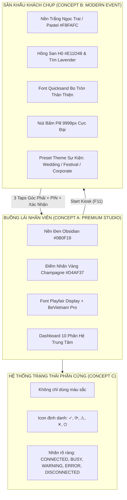

# 1998 TEAM PHOTOBOOTH — DESIGN DIRECTION (ROUND 2 REFINED)
## Định Hướng Thiết Kế Lai Ghép (Hybrid Architecture) & Đặc Tả UX Vận Hành

> **Dự án:** 1998 TEAM Photobooth Redesign  
> **Quyết định phê duyệt:** HYBRID DIRECTION (Chủ dự án phê duyệt Round 2)  
> **Kiến trúc cốt lõi:**  
> • **Operator Cockpit:** Concept A — Premium Studio (Đen Obsidian & Vàng Champagne)  
> • **Guest / Kiosk Mode:** Concept B — Modern Event (Trắng ngọc trai, Hồng san hô & Tím pastel)  
> • **Device Status Telemetry:** Concept C — Trạng thái đa kênh (Icon + Nhãn văn bản + Viền + Màu)  
> • **Slot-based Retake:** 4 Slots chuẩn, hỗ trợ chụp lại riêng ô #2 và bảo toàn 100% các ô còn lại  
> • **Kiosk Security:** Thao tác bí mật + PIN ẩn + Rung lắc báo sai + Khóa 30s + Xác nhận thoát  
> • **Bảo toàn Camera Engine:** Tuyệt đối không can thiệp Nikon MAID, WPD, Face/Eye AF, Capture Transaction

---

## 1. MÔ HÌNH THIẾT KẾ LAI GHÉP (HYBRID DESIGN PHILOSOPHY)

Sự kết hợp giữa Concept A cho Buồng Lái Vận Hành và Concept B cho Sân Khấu Kiosk Khách Chụp tạo ra giải pháp hoàn hảo:



---

## 2. QUY CHUẨN 4-SLOT RETAKE ĐỘC LẬP (SLOT-BASED RETAKE UX)

Khác biệt với các ứng dụng photobooth web thông thường vốn xóa sạch toàn bộ ảnh khi chụp lại, 1998 TEAM chuẩn hóa quy trình **Chụp lại theo ô con (Slot-based Retake)**:

1. **Chuỗi chụp ban đầu:** Khách chụp liên hoàn 4 ô tương ứng 4 tư thế:
   - `Ô #1:` Tư thế chào đón / Vẫy tay.
   - `Ô #2:` Tư thế thả tim.
   - `Ô #3:` Tư thế cười tươi.
   - `Ô #4:` Tư thế nháy mắt.
2. **Màn hình Review:**
   - 4 ô ảnh hiển thị trên dải preview với số thứ tự và nút thao tác riêng: `🔄 Chụp lại ô #1`, `🔄 Chụp lại ô #2`, `🔄 Chụp lại ô #3`, `🔄 Chụp lại ô #4`.
3. **Kích hoạt Retake ô #2:**
   - Khách bấm vào ô #2.
   - Khung Live View hiển thị biểu ngữ nổi bật: `🔄 ĐANG CHỤP LẠI RIÊNG Ô SỐ 2 (CÁC Ô 1, 3, 4 ĐƯỢC BẢO TOÀN NGUYÊN VẸN)`.
   - Đếm ngược 3s có âm thanh đếm nhịp và chớp flash.
   - **Ảnh mới chỉ được gán vào duy nhất slot #2**, đóng dấu `✓ ĐÃ CHỤP LẠI`.
   - Các slot #1, #3, và #4 giữ nguyên vẹn 100% dữ liệu ảnh gốc.
   - Hệ thống quay về màn hình Review và hiển thị nhật ký xác nhận: `TRẠNG THÁI BẢO TOÀN: Ô #1 (Ảnh Gốc) | Ô #2 (Đã Chụp Lại) | Ô #3 (Ảnh Gốc) | Ô #4 (Ảnh Gốc)`.

---

## 3. CƠ CHẾ BẢO MẬT KIOSK ĐA TẦNG (KIOSK SECURITY ARCHITECTURE)

Nhằm bảo vệ tuyệt đối thiết bị tại sự kiện đông người mà không làm phiền khách:

```
[MÀN HÌNH KIOSK KHÁCH]
       │
       ▼  (Khách không thấy nút thoát nào)
       │  (Thao tác bí mật: Chạm 3 lần góc phải trên cùng HOẶC phím F11)
[BÀN PHÍM PIN CẢM ỨNG (MÃ HÓA ••••)]
       │
       ├─► [Nhập Sai]: Rung lắc bàn phím (Shake) + Báo lỗi "Sai X/3 lần"
       │         │
       │         └─► [Sai Quá 3 Lần]: Khóa bàn phím an toàn trong 30 giây
       │
       └─► [Nhập Đúng PIN (Mặc định 1998, có thể đổi)]:
                 │
                 ▼
          [MODAL XÁC NHẬN THOÁT]
          "Xác nhận thoát Kiosk sang Buồng Lái Operator?
           Phiên chụp của khách sẽ kết thúc."
                 │
                 ├─► [HỦY] ──► Tiếp tục ở lại Kiosk
                 └─► [XÁC NHẬN] ──► Chuyển sang Operator Cockpit
```

---

## 4. BẢO TOÀN NGUYÊN VẸN CAMERA ENGINE (BẮT BUỘC)

Trong toàn bộ quá trình tái thiết kế UI/UX:
- **Nikon MAID SDK (Type0026), Windows WPD, Face/Eye AF Controller, Live View Worker và Capture Transaction giữ nguyên trạng thái đóng băng.**
- Việc chuyển đổi giữa các tab trên giao diện Operator hoặc giữa Operator và Kiosk **không bao giờ được ngắt session máy ảnh, không giải phóng buffer Live View, không làm mất điểm lấy nét**.
- Bản mẫu tương tác mô phỏng đầy đủ hành vi luồng camera mà không giả mạo đang điều khiển phần cứng thật.
